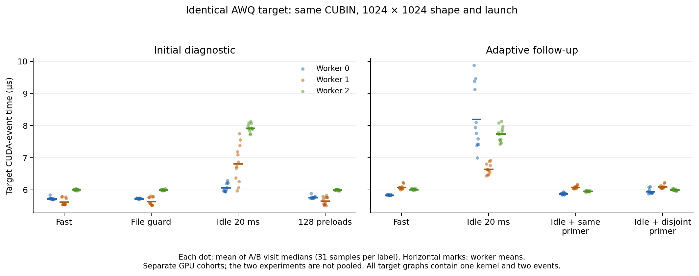

# 同 CUBIN、同 shape 的时间漂移：独立环境干扰调查

本轮调查的对象是**完全相同的目标程序和输入为什么会测出不同时间**。不比较跨尺寸收益，不比较布局优劣，不修改编译器，也不继续布局选择模型或下一阶段研究。

结论：主动插入 20 ms 空闲，在两批 H100 上都使相同目标程序变慢；一次使用不同 CUBIN、独立存储的未计时 kernel 就能恢复大部分差异。这是可重复的执行历史效应，不能仅因变化以 µs 计就当成随机误差删除。具体硬件原因尚未识别，**没有证明 DVFS，也没有唯一确定历史异常的原因**。

## 1. 历史异常确实发生在同一程序、同一尺寸内

固定目标为公开 AWQ 反量化 U：`N02_k1024_p128_g128`，packed 输入 1024×128，输出 1024×1024，group=128，grid=`(4,32,1)`，4 warps。完整 CUBIN SHA256：

```text
cd5dad8709d09c326f4f9e703fe28f76586f5589ddf8ab1a29e02c15debedd6d
```

从原始数据重新计算的同 worker、同已加载函数观测：

| 历史记录 | Visit | 31 样本中位数 | 后一次相对变化 |
|---|---|---:|---:|
| N1 r2 / worker 001 | 3 → 4 | 5.952 → 8.352 µs | +40.32% |
| N1 r3 / worker 002 | 6 → 8 | 5.824 → 8.480 µs | +45.60% |

后一条中 G0 同时由 5.792 变到 8.544 µs。不是一个孤立最大值改变了均值：旧记录每个 visit 均含 31 个完整原始样本。这些旧记录没有频率或功率遥测，因此不倒推其实际时钟状态。

路径、UUID、完整 binding、原始文件 SHA、全部 visit 中位数及另外 42 条 N2/N4 同配置重复记录，保存在 [historical_audit.json](same_program_001/preregistration/historical_audit.json)。历史原始样本与 compiler artifacts 均未修改。

## 2. 首轮：只改变样本之间的条件

[预冻结协议](same_program_001/preregistration/protocol.json) 在新 GPU 计时之前写入。每台 worker 只加载一个 U function，固定同一 context、stream、输入指针、参数向量、grid 与单目标 graph。graph 始终是一个 kernel 和两个外部计时 event。A/B 只是同一 graph 的两组独立、随机交错的观测标签。

三台 H100，各 12 visits × 每标签 31 samples × 四种条件 × A/B，共 **8,928 个目标原始样本**。每 visit 先取中位数，再对 worker/visit 等权平均；8192 次配对分层 bootstrap 在所有条件间共用抽样索引。条件顺序均衡，A/B 每轮随机。

| 条件 | 目标时间 | 相对 fast 的时间变化 |
|---|---:|---:|
| 连续快速采样 | 5.7836 µs | 参考 |
| 每样本读取并哈希文件与已加载字节 | 5.7893 µs | +0.0058 µs；±3% 实用等价 |
| 每样本空闲 20 ms | 6.9373 µs | **+19.95%，95% CI [6.07%,31.81%]** |
| 目标前运行 128 次未计时预负载 | 5.8053 µs | +0.0218 µs；±3% 实用等价 |

三台卡的空闲效应分别为 +5.91%、+21.38%、+32.00%。四种条件的 A/B sham 区间全部在 ±3% 内。文件读取、sleep、预负载与 CPU oracle 均不在目标 event 区间内。

这是 `/tmp` 中暖文件读取的对照，不能冒充历史 Modal Volume 路径的完全复刻。结果也反对“任何较长 host 间隙都必然变慢”的简单说法：几十 µs 的 guard 与本轮 128 次预负载均没有产生 >3% 的目标差异。

详见 [分析与完整区间](same_program_001/analysis/REPORT.md)、[原始数据入口](same_program_001/timing)、[最终 validator](same_program_001/validation_final.json)。

## 3. 自适应跟进：是否必须重读相同目标数据才能恢复

看到首轮结果后，新增 [独立冻结协议](wake_001/preregistration/protocol.json)，在另三台 H100 上采集 **8,928 个新目标样本**，不与首轮混算。每个新 worker 内固定同一 U 目标、输入指针、参数、grid、函数和 graph；不同 GPU 批次不共用指针或句柄。

两个额外条件都先空闲 20 ms，再运行一次未计时 primer：

- same-prime：使用目标自身的 graph 和数据。
- disjoint-prime：使用既有冻结 `GL_packed_compute_vec1` CUBIN，全部输入、输出、scratch 单独分配，函数、module、graph 与所有存储范围均不同。它只是设备活动对照，不是本轮的布局收益比较。

| 条件 | 目标时间 | 与连续条件的关系 |
|---|---:|---|
| 连续快速采样 | 5.9756 µs | 参考 |
| 空闲 20 ms | 7.5289 µs | **+25.99%，95% CI [9.57%,40.00%]** |
| 空闲后 same-prime | 5.9716 µs | ±3% 实用等价 |
| 空闲后 disjoint-prime | 6.0138 µs | ±3% 实用等价 |

idle−fast 为 **1.5533 µs，95% CI [0.5808,2.3485] µs**，三台 worker 同方向。disjoint-prime 相对未预热 idle 恢复 **1.5151 µs，CI [0.5551,2.2644] µs**；恢复比例为 97.54% [94.53%,100.90%]，比例区间直接使用共享重采样，允许超过 100%。四组 A/B sham 仍全部实用等价。

这说明**精确重用目标的相同输入与 cache line 不是恢复的必要条件**。两个 primer 都改变 GPU 和共享缓存的运行历史，因此不能进一步声称已经排除所有 cache 作用，或已定位 clock gating、调度、event 路径中的某一项。

详见 [跟进分析](wake_001/analysis/REPORT.md)、[原始数据入口](wake_001/timing)、[最终 validator](wake_001/validation_final.json)。

## 4. µs 变化与统计噪声怎样区分

不能用绝对时间单位过滤结果：约 6 µs 的目标增加 1.55 µs，是约 26%，不是一个可以忽略的末位波动。这里有三台独立 worker 的匹配条件对照、随机 A/B sham、每 visit 中位数、整组保留与配对区间，而不是挑两次 launch 作比较。

同时，统计显著不等于实用收益：same-prime 比 disjoint-prime 短约 **0.0422 µs（0.70%）**，CI 为 [0.0178,0.0733] µs，虽然不跨零，仍在预定 ±3% 的实用等价带内，不据此宣称一种 primer 实用地更优。

每批的独立 GPU 数是 **3**，不是 8,928；31 次采样和 8192 次 bootstrap 不会创造新的独立硬件。区间依赖当前采样设计，不能保证对全部 Modal worker 或别的 GPU 成立。两批各自分析，不把两次百分比差异解释成新机制。

应控制并单列这种条件效应，不删除慢样本、不只保留稳定 worker，也不把本轮 20%/26% 从历史布局收益中直接减掉。



每个点为同一 worker/visit 中 A/B 的 31 样本中位数均值；横线为 worker 均值。两个 panel 是不同 GPU 批次。[PDF](same_program_repeatability.pdf) 可单独导出。

## 5. 遥测：没有观测到 nominal clocks 降低

首轮 5,923、跟进 16,243 条 NVML 记录，共 **22,166 条**；所有十个读取项返回码均为 0，没有 sampler 错误。所有查询均报告：

- SM/graphics：1980 MHz；memory：2619 MHz；Pstate：P0。
- clock-event mask：0；功率上限：700 W。
- 温度范围：首轮 33–41°C；跟进 29–38°C。

因此没有观测到伴随变慢的 nominal-clock 降低、热限制或 clock-event 标志，不能把结果写成“DVFS 已证实”。10 ms 轮询仍远长于约 6 µs 的 kernel，fast timing block 的覆盖尤其稀疏：首轮每 worker 只有一次查询。瞬态 gating、有效执行时钟、调度等因素尚未分别辨识，采样值不等于每个 kernel 的固定频率证明。

H100 上 NVML 的功率值为一秒平均，利用率也使用硬件平均窗；查询时间不能使它们成为每个 kernel 的即时功率或利用率。[NVIDIA NVML queries](https://docs.nvidia.com/deploy/nvml-api/latest/api/group__nvmlDeviceQueries.html)、[utilization 窗口](https://docs.nvidia.com/deploy/nvml-api/latest/api/structnvmlUtilization__t.html) 与 [NVIDIA 性能测量指南](https://docs.nvidia.com/deeplearning/tensorrt/10.x.x/performance/hw-sw-environment.html) 支持这些解释边界。

本轮没有设置频率。先前的 [权限探针](probe_001/REPORT.md) 在三台 H100 上均返回 permission denied；容器 uid=0 且未持有有效 CAP_SYS_ADMIN，与设备管理权限不可用一致，但未证明宿主权限检查的具体路径。不能绕开权限把 default boost 或采样 clocks 称为成功锁频。[NVML 管理操作权限](https://docs.nvidia.com/deploy/nvml-api/latest/api/group__nvmlDeviceCommands.html)、[Modal 隔离说明](https://modal.com/docs/guide/security)。

## 6. 历史 Volume 文件检查也是潜在的间隙来源

历史 harness 在 Modal Volume 中解压并逐样本执行文件 guard；首轮诊断文件位于 `/tmp`。跟进任务在 GPU teardown 后，另对相同文件与 retained bytes 作 128 次/路径、随机交错的 read+hash 检查：

| Worker | `/tmp` 中位数 | Modal Volume 中位数 | Volume 最大值 |
|---|---:|---:|---:|
| 0 | 79.21 µs | 283.45 µs | 710.82 µs |
| 1 | 88.19 µs | 253.15 µs | 683.44 µs |
| 2 | 89.66 µs | 261.54 µs | 442.58 µs |

各 worker 的 `timing/invocation_*/export/io_probe.json` 保存全部主机观测。这证明文件位置影响 host cadence，**不重建过去的冷读、远程存储停顿或历史 GPU 因果关系**；本轮也没有测到 Volume 读取达到 20 ms。不得据此把历史 45.6% 漂移唯一归因于 guard。

## 7. 对主实验的处理建议与停点

1. 对比布局时固定样本间活动、预热、缓存与恢复策略；同轮交错默认与候选，并保留独立同程序 sham、worker/visit 漂移和 host 时间戳。
2. 将空闲后的首用与持续执行分开定义和报告。一次预负载能控制本次干扰，但它改变运行情境，不能默默加上后把旧实验重新解释为真实首用性能。
3. 文件 SHA 与 loaded-buffer guard 放在明确的块边界，避免把文件系统节奏隐含绑定到每个计时样本；调整测量方法时保存新协议和同条件新对照。
4. 如果 sham 不等价或区间无法分辨实用阈值，保留结果为不确定，按预定统一规则复测，不筛掉不利样本。旧布局结果不作机械修正；本轮也未测量不同布局对这些条件的交互敏感性。
5. 如需细分 gating、前端调度、cache 或 event 开销，还需要独立硬件/时间线对照。NVML 采样自身的影响未单独消融，未把其排除。这里先停在可复核的运行历史干扰结论。

两次 validator 均为 `OK`，分别重算全部分析、校验目标 identity/ABI/资源/完整 oracle/guard、原始档案、遥测及受保护历史 SHA。目标 n_regs=72、local=0、q=7；disjoint primer n_regs=40、local=0、q=12。全部重用既有 compiler image 与冻结二进制，Triton 导入、kernel compilation、native rebuild 均为 0。

Modal 运行：[首轮](https://modal.com/apps/chenmiaoming/main/ap-8Ur0afEt0O21HWX6hYa0K3)、[独立跟进](https://modal.com/apps/chenmiaoming/main/ap-qgpgS1jERUvvCSi4mZaXTU)。本次总计 17,856 个目标计时样本、36 项完整正确性检查，分两批各三台、合计六个不同 GPU UUID。未创建 PR，未推进布局研究的下一阶段。
