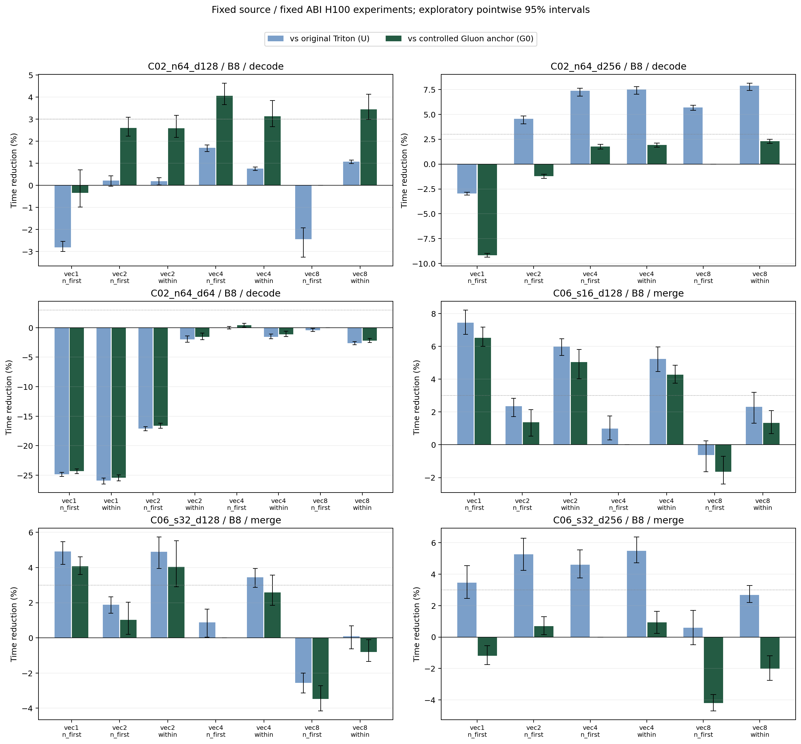

# G2 — 两个推理入口的源码复现与受控布局对照

本批在 H100 上完成 C06 vLLM segment merge 与 C02 SGLang normal decode 的源码级实验。
**非 TMA 的实际算子中存在布局改选收益，也存在改选退化；收益取决于形状、工作负载和周边布局转换。**
这支持继续研究共同的布局选择问题，尚不证明所有 reduction 都有缺陷或现成 cost model 已能泛化。

## 1. 本次测了什么

- C06：[固定 vLLM 源码](https://github.com/vllm-project/vllm/blob/76c9e23ce7dd4646616e3b282d6263cc47ac17a6/vllm/v1/attention/ops/triton_unified_attention.py)。
  提取 `reduce_segments` 及原 helper，保留 sequence 二分查找、padding/零长度早退、segment max/expsum、FP32 scratch 与 BF16 输出。
  测的是 use_3d/scratch 分支的 merge；未计前置 attention，未安装整个 serving package。
- C02：[固定 SGLang 源码](https://github.com/sgl-project/sglang/blob/c2e574246485a055c0e51d60d1eae027e5d629c0/python/sglang/kernels/ops/attention/decode_attention.py)。
  non-GQA，PAGE_SIZE=1，32 Q/KV heads，4 splits，保留 QK、BF16 乘积精度、在线 softmax、分页索引、PV 与原始 stage2。
  只改变 PV 矩阵布局；Q/K、概率计算、输出编码固定。stage1 和 stage1+stage2 分别计时。
- C06：三种 segment×head_dim，batch=1/8/64，context=8192；C02：BLOCK_N=64，head_dim=64/128/256，batch=1/8，context=256/2048。
  输入为合成 serving 尺度数据，不是捕获的模型轨迹；GQA/tl.dot、其他 page size、FP8 KV、sink/score_mod 未测试。
- 三组程序：U 是原始 Triton 函数体；G0 是使用实际默认输入编码的受控 Gluon 锚点；GL 是同一 Gluon 函数的布局参数干预。
  **U↔G0 的 SASS/寄存器并不全部相同，未建立整个 lowering 的等价桥接。纯布局对照使用 G0↔GL。**

## 2. 编译、正确性与统计协议

固定 compiler identity `20d9d98fead78c2f65e1b3ba5a7881d86a836dad`，native SHA `fc5f2ad73f9f8c8ab31c3a01b8124329ccec391cdc5dbf2dafb2d42778cf6adb`。
复用已有 image/ccache/kernel cache，CPU preflight 原源码 9/9、受控 Gluon 47/47 通过；真实 CUDA tensor JIT 绑定导出 56 个逻辑程序、50 个不同 CUBIN。
三个编译过程的 ccache 统计前后相同，native SHA 不变，native rebuild 为 0。

独立无 Triton 进程加载冻结 CUBIN，159/159 正确性检查通过，含输入原字节、两侧 canary、完整输出、padding/inactive splits；C02 同时检查 partial、LSE 和 stage2 最终输出。
正式计时的每个条件也在采样后检查完整输出。FP32 rtol=2e-4/atol=2e-5，BF16 rtol=.008/atol=1e-4，原 BF16 乘积语义保留。

计时为单次调用 CUDA Graph 的设备事件时间：3 个独立 worker 进程，5 次访问/条件，每次 8 warmup+31 样本，预固定种子配对随机顺序。
共 **121,365 原始样本、261 个物理条件、783 个 worker 条件单元、294 个逻辑条件、33 组工作负载**。
估计量为各 worker/visit 的样本中位数的平均值；95% CI 用 worker/visit 配对分层 bootstrap 4096 次。
CI 是探索性逐项区间，未做多重比较校正。表中“最快”按本次实测事后取最小值，不是冻结选择器或独立确认性验证；未因输赢追加重复。
gain=(基线时间−候选时间)/基线时间，正值为耗时下降。3% 是预设实用差异门槛。

实际时间单位始终是 **µs/call**，没有换成 MC 循环斜率或混入历史 ns/tile/SM。
NCU 独立采集，不用于正式时间。三名 timing worker UUID 与 driver/device 记录见 `timing_analysis.json`。

## 3. 默认到底是什么布局

下表来自真实 U 的优化 TTGIR。C06 的 scratch 是 FP32，默认 vec4；C02 的 BF16 V 默认 vec8。
S/M 方向分别是 segment/token，D/N 方向是 head dimension；每项都是 4 warps。

| geometry | sizePerThread | threadsPerWarp | warpsPerCTA | U / G0 n_regs |
| --- | --- | --- | --- | --- |
| C06_s16_d128 | [1, 4] | [1, 32] | [4, 1] | 32 / 32 |
| C06_s32_d128 | [1, 4] | [1, 32] | [4, 1] | 56 / 48 |
| C06_s32_d256 | [1, 4] | [1, 32] | [2, 2] | 96 / 80 |
| C02_n64_d64 | [1, 8] | [4, 8] | [4, 1] | 56 / 56 |
| C02_n64_d128 | [1, 8] | [2, 16] | [4, 1] | 83 / 80 |
| C02_n64_d256 | [1, 8] | [1, 32] | [4, 1] | 127 / 144 |

Q/K、statistics 与 output 的完整编码见 `compile_gate.json`。C06 原编译器还可能复制 statistics load 到不同编码，G0 只固定其选定的 1D statistics 编码。
因此“输入矩阵编码相同”不能代替全图 lowering 等价；NCU 中 U/G0 的通信差异也确实存在。

## 4. Batch=8 主展示与完整矩阵

C06 是 merge/context8192；C02 是完整两阶段 decode/context2048。所有候选和所有 batch/context，包括 stage1，见 [MATRIX.md](MATRIX.md) 与 [all_timings.csv](all_timings.csv)。

| geometry | U µs | G0 µs | 实测最快 GL | GL µs | gain vs U | gain vs G0 | CI95 vs G0 (%) |
| --- | --- | --- | --- | --- | --- | --- | --- |
| C02_n64_d128 | 102.959 | 105.485 | vec4:n_first | 101.212 | +1.70% | +4.05% | [+3.65, +4.63] |
| C02_n64_d256 | 206.539 | 194.771 | vec8:within | 190.285 | +7.87% | +2.30% | [+2.09, +2.49] |
| C02_n64_d64 | 54.724 | 54.953 | vec4:n_first | 54.720 | +0.01% | +0.42% | [+0.10, +0.72] |
| C06_s16_d128 | 6.441 | 6.377 | vec1:n_first | 5.961 | +7.45% | +6.52% | [+6.01, +7.18] |
| C06_s32_d128 | 6.767 | 6.707 | vec1:n_first | 6.434 | +4.92% | +4.07% | [+3.61, +4.61] |
| C06_s32_d256 | 7.460 | 7.117 | vec4:within | 7.051 | +5.49% | +0.93% | [+0.24, +1.64] |



需要分别读这些结果：

- C06 `s16_d128` 的 vec1 在 batch1/8/64 下，相对 G0 分别快 6.13%/6.52%/12.28%；`s32_d128` 的 batch8/64 为 4.07%/9.09%。这是同一受控 Gluon 程序内的布局收益。
- C06 `s32_d256` 最快布局相对 G0 只有 0.07%/0.93%/0.17%；相对 U 的较大差值主要混有 lowering 桥接差异，不能当成纯布局收益。
- C02 `d128` 在 batch8 下，vec4:N-first 的两阶段收益相对 G0 是 context256 的 4.26% 与 context2048 的 4.05%；相对 U 分别是 5.65% 与 1.70%。
- C02 `d256` 的 vec8:within 在 batch1/context2048 与 batch8/context256 相对 G0 分别快 4.74% 与 7.90%；batch8/context2048 只有 2.30%，未达到 3% 实用门槛。
  batch1/context2048 相对 U 的 42.30% 包含很大的 U→G0 lowering 差异，不能宣称为 42.30% 的布局效果。
- **vec1 有明确反例**：C02 `d64` batch8/context2048 的两阶段时间，相对 U 慢 24.84%、相对 G0 慢 24.33%；`d128` batch1/context2048 相对 G0 慢 13.66%。
  简单将所有列 reduction 改为 vec1 没有本批证据支持。

## 5. 实际动态计数：普通 load 仍有通信与转换成本

12 份 NCU 原始报告：每个 geometry 一份单 CTA software 与一份 batch8 实际 grid hardware，合计各 30 次 kernel。
software 使用 NCU `Instructions Executed`，下表 LDS/STS/SHFL/BAR 是**单 CTA 的 warp 指令执行实例数**，BAR 只数 `BAR.SYNC`；不是每线程标量指令数，也不是串行延迟。
C02 software 的一个 CTA 处理 context2048/splits4，即 8 个 KV 循环，计数包含完整 QK/softmax/PV/output，不能全部归给 PV。
hardware 的 WF、BC、global sector request 是全 grid 的 `.sum / CTA数`；平均值可能非整数，小的正 bank conflict 读数原样保留。
software 与 hardware 是两个独立采集模式，不能把软件指令数量直接等同于硬件波前。

| 程序 | regs / q_cap | LDS / STS | SHFL / BAR | load WF/CTA | store WF/CTA | load BC/CTA | global LD sectors/CTA | global ST sectors/CTA |
| --- | --- | --- | --- | --- | --- | --- | --- | --- |
| C06_s16_d128:upstream | 32 / 16 | 12 / 24 | 64 / 20 | 36.00 | 48.00 | 0.00 | 324.5 | 8.0 |
| C06_s16_d128:gluon_anchor | 32 / 16 | 40 / 52 | 64 / 52 | 72.00 | 104.00 | 0.00 | 292.5 | 8.0 |
| C06_s16_d128:vec1:n_first | 32 / 16 | 20 / 4 | 32 / 12 | 40.35 | 8.00 | 0.35 | 292.5 | 8.0 |
| C06_s16_d128:vec2:within | 32 / 16 | 12 / 8 | 64 / 12 | 20.04 | 8.00 | 0.04 | 292.5 | 8.0 |
| C06_s16_d128:vec8:within | 32 / 16 | 12 / 56 | 144 / 8 | 16.00 | 128.00 | 0.00 | 548.5 | 8.0 |
| C06_s32_d128:upstream | 56 / 9 | 12 / 24 | 72 / 20 | 36.00 | 48.00 | 0.00 | 628.5 | 8.0 |
| C06_s32_d128:gluon_anchor | 48 / 10 | 60 / 52 | 72 / 52 | 96.00 | 104.00 | 0.00 | 564.5 | 8.0 |
| C06_s32_d128:vec1:n_first | 47 / 10 | 40 / 4 | 40 / 12 | 80.61 | 8.00 | 0.61 | 564.5 | 8.0 |
| C06_s32_d128:vec2:within | 48 / 10 | 20 / 8 | 72 / 12 | 40.13 | 8.00 | 0.13 | 564.5 | 8.0 |
| C06_s32_d128:vec8:within | 46 / 10 | 28 / 64 | 136 / 24 | 36.01 | 136.00 | 0.01 | 1076.5 | 8.0 |
| C06_s32_d256:upstream | 96 / 5 | 12 / 16 | 56 / 20 | 36.00 | 40.00 | 0.00 | 1204.5 | 16.0 |
| C06_s32_d256:gluon_anchor | 80 / 6 | 100 / 40 | 56 / 52 | 156.03 | 96.00 | 8.03 | 1076.5 | 16.0 |
| C06_s32_d256:vec1:n_first | 80 / 6 | 56 / 24 | 40 / 36 | 100.02 | 36.00 | 0.02 | 1076.5 | 16.0 |
| C06_s32_d256:vec2:n_first | 80 / 6 | 40 / 4 | 40 / 12 | 80.55 | 8.00 | 0.55 | 1076.5 | 16.0 |
| C06_s32_d256:vec8:within | 80 / 6 | 28 / 48 | 104 / 24 | 48.10 | 120.00 | 8.10 | 2100.5 | 16.0 |
| C02_n64_d64:upstream | 56 / 9 | 132 / 136 | 1664 / 264 | 325.02 | 384.99 | 1.02 | 4252.0 | 9.0 |
| C02_n64_d64:gluon_anchor | 56 / 9 | 140 / 184 | 1664 / 280 | 337.09 | 485.92 | 1.09 | 4252.0 | 9.0 |
| C02_n64_d64:vec1:n_first | 79 / 6 | 896 / 224 | 672 / 448 | 1664.50 | 529.19 | 0.50 | 4252.0 | 9.0 |
| C02_n64_d64:vec2:within | 64 / 8 | 460 / 176 | 768 / 344 | 1616.08 | 496.60 | 768.08 | 4252.0 | 9.0 |
| C02_n64_d64:vec8:within | 64 / 8 | 172 / 216 | 1664 / 344 | 464.04 | 594.50 | 192.04 | 4252.0 | 9.0 |
| C02_n64_d128:upstream | 83 / 5 | 228 / 204 | 1984 / 396 | 612.12 | 658.32 | 0.12 | 8468.0 | 17.0 |
| C02_n64_d128:gluon_anchor | 80 / 6 | 524 / 328 | 1984 / 600 | 944.25 | 864.31 | 32.25 | 8468.0 | 17.0 |
| C02_n64_d128:vec1:n_first | 127 / 4 | 1920 / 320 | 1216 / 512 | 3488.59 | 968.91 | 32.59 | 8468.0 | 17.0 |
| C02_n64_d128:vec2:within | 96 / 5 | 1152 / 320 | 1304 / 512 | 1952.37 | 969.34 | 32.37 | 8468.0 | 17.0 |
| C02_n64_d128:vec8:within | 95 / 5 | 588 / 376 | 1984 / 524 | 1200.13 | 1102.48 | 416.13 | 8468.0 | 17.0 |
| C02_n64_d256:upstream | 127 / 4 | 204 / 200 | 3200 / 404 | 600.47 | 646.29 | 0.47 | 16924.0 | 33.0 |
| C02_n64_d256:gluon_anchor | 144 / 3 | 304 / 264 | 3200 / 672 | 892.33 | 870.94 | 104.33 | 16924.0 | 33.0 |
| C02_n64_d256:vec1:n_first | 191 / 2 | 1712 / 500 | 2688 / 600 | 3447.17 | 1847.97 | 99.17 | 16924.0 | 33.0 |
| C02_n64_d256:vec2:n_first | 154 / 3 | 1696 / 480 | 2688 / 576 | 3424.28 | 1796.84 | 96.28 | 16924.0 | 33.0 |
| C02_n64_d256:vec8:within | 167 / 3 | 560 / 520 | 3200 / 588 | 1916.30 | 1908.95 | 872.30 | 16924.0 | 33.0 |

`q_cap` 是 CUDA occupancy API 给出的最大驻留容量，不是实测活跃 CTA 数。所有 56 个程序的静态 local bytes 为 0；本批没有 spill 事件证据。
完整十项硬件计数、DRAM read/write/利用率与逐 PC 数据保存在 `counter_analysis.json`。
本地 CPU 已独立重导入 12/12 `.ncu-rep`，数值与逐 PC 指令均与远端导入一致；本地 NCU 2026.3.1，采集 NCU 2025.4.1。

这些计数支持的解释及边界：

1. C06 `s16_d128`，G0→vec1 的 global LD sectors 都是 292.5/CTA，而 SHFL 64→32、BAR 52→12，shared store WF 104→8；`s32_d128` 也出现同类通信削减。
   普通 pointer load 的布局收益因此不要求存在 TMA。这里的 shared traffic 来自规约及布局转换，不是把源 `tl.load` 说成显式 TMA/shared 输入。
   计数变化与时间收益方向一致，但本批没有把每个通信子项独立计时，不能逐项分配收益百分比。
2. 同样是 C06 `s16_d128`，vec8:within 的 global LD sector requests 是 548.5/CTA，约为 G0 的 1.88 倍；load WF 更低并不保证更快，SHFL 和 shared store 也在增加。
   必须看真实访问分布与硬件计数，不能用 `32/vec` 代替硬件加载次数或带宽成本。
3. C02 `d64` G0→vec1：global LD sectors 都是 4252/CTA，但 load WF 337.09→1664.50、BAR 280→448、regs 56→79，容量 q 从 9→6。
   减少规约 fanout 同时引入了周边转换/资源成本；SHFL 虽从 1664 降至 672，完整 decode 仍然变慢。这是保留 QK/softmax/output 上下文的重要反例。
4. C02 `d256` G0→vec8:within 的 load BC 104.33→872.30/CTA，load WF 892.33→1916.30，但部分 workload 的时间反而下降。
   单个 WF/BC 计数也不是总耗时模型；调度、转换、依赖和流量掩盖仍需后续受控实验辨识。不能从这些共变计数直接宣称唯一原因。
5. 本轮预指定计数集合没有 C02 的 vec4:N-first，所以它的收益已有正式时间证据，尚没有该候选的专门动态机制归因。未看到最快结果后临时扩大 NCU 选择集合。

## 6. 全部 batch/context 的两阶段或 merge 概览

下表保留所有 21 个 merge/decode 工作负载；另外 12 个 stage1 条件在 `MATRIX.md` 中逐项列出。最快 GL 只表示探索性观测，不等于部署建议。

| geometry | batch | context | mode | U µs | 实测最快 GL | gain vs U | gain vs G0 |
| --- | --- | --- | --- | --- | --- | --- | --- |
| C02_n64_d128 | 1 | 256 | decode | 9.361 | vec2:within | +2.51% | +0.44% |
| C02_n64_d128 | 1 | 2048 | decode | 23.699 | vec8:within | +6.81% | +0.27% |
| C02_n64_d128 | 8 | 256 | decode | 16.348 | vec4:n_first | +5.65% | +4.26% |
| C02_n64_d128 | 8 | 2048 | decode | 102.959 | vec4:n_first | +1.70% | +4.05% |
| C02_n64_d256 | 1 | 256 | decode | 12.113 | vec8:n_first | +14.53% | +0.00% |
| C02_n64_d256 | 1 | 2048 | decode | 71.563 | vec8:within | +42.30% | +4.74% |
| C02_n64_d256 | 8 | 256 | decode | 38.317 | vec8:within | +12.88% | +7.90% |
| C02_n64_d256 | 8 | 2048 | decode | 206.539 | vec8:within | +7.87% | +2.30% |
| C02_n64_d64 | 1 | 256 | decode | 8.576 | vec4:n_first | -0.40% | +1.03% |
| C02_n64_d64 | 1 | 2048 | decode | 15.068 | vec8:n_first | -0.88% | +0.00% |
| C02_n64_d64 | 8 | 256 | decode | 11.614 | vec4:n_first | -0.73% | +3.60% |
| C02_n64_d64 | 8 | 2048 | decode | 54.724 | vec4:n_first | +0.01% | +0.42% |
| C06_s16_d128 | 1 | 8192 | merge | 5.990 | vec1:n_first | +8.97% | +6.13% |
| C06_s16_d128 | 8 | 8192 | merge | 6.441 | vec1:n_first | +7.45% | +6.52% |
| C06_s16_d128 | 64 | 8192 | merge | 9.918 | vec1:n_first | +14.09% | +12.28% |
| C06_s32_d128 | 1 | 8192 | merge | 6.165 | vec2:within | +8.20% | +2.78% |
| C06_s32_d128 | 8 | 8192 | merge | 6.767 | vec1:n_first | +4.92% | +4.07% |
| C06_s32_d128 | 64 | 8192 | merge | 13.941 | vec1:n_first | +16.79% | +9.09% |
| C06_s32_d256 | 1 | 8192 | merge | 6.492 | vec4:within | +8.81% | +0.07% |
| C06_s32_d256 | 8 | 8192 | merge | 7.460 | vec4:within | +5.49% | +0.93% |
| C06_s32_d256 | 64 | 8192 | merge | 31.441 | vec4:within | +5.75% | +0.17% |

## 7. 已知限制与保留的失败

详见 [SOURCE_BINDING_SCOPE.md](SOURCE_BINDING_SCOPE.md)：固定真实 JIT 绑定调用为 batch4/length129，再用同一合法 ABI 重放各 workload。
C06 num_seqs 的实际 package JIT 在 batch1 可能特化常量1，在 batch64 可能增加整除属性；本批没有逐 workload 重走 serving 库分派。
因此这里是固定 ABI 的源码级对照，不能精确替代每个实际 package 默认 binary 的时间。
时间为 warm CUDA Graph，不含 Python 调度、前置 attention、数据准备或整个 LLM。缓存内小图与大图不可直接合并为端到端模型收益。
U→G0 的桥接差异、事后最快候选的选择偏差、单架构/合成输入的外推范围均保留，不据此修改旧 cost model。

NCU attempt001 因查询 suffix 的 CLI 参数不完整，在 kernel 采集前失败，六份记录全部保留。
CPU 本地和采集 image 均完成修正后查询验证，再启动 attempt002。
attempt002 的 C06 全部成功；C02 因单 CTA 校验掩码为只读 broadcast view，在启动 kernel 前失败。
profile protocol v3 只将该掩码复制为私有可写数组，并只重试三个 C02 worker；C06 报告、原 CUBIN、正式计时、预指定 NCU 代表集合均未重跑或改变。
失败导出、各版源码快照、dispatch/call ID、报告 SHA 与 worker UUID 全部留存。

## 8. 复核入口与停点

```bash
.venv/bin/python -B -m experiments.tma_reduction_layout.phase11.operator_gpu.validate_g1
.venv/bin/python -B -m experiments.tma_reduction_layout.phase11.operator_gpu.validate_g2
```

`preregistration/protocol.json` 固定矩阵和统计口径；`compiled_payload.zip`、`compile_gate.json` 固定实际 CUBIN/ABI；
`timing/invocation_*/raw.json` 保留全部原始样本；`profiles/*/attempt_*/export` 保留原始 NCU/编译绑定；
`offline_import_validation.json` 保存本地独立复核；`FREEZE.json` 对本阶段源代码和证据逐文件记录 SHA。

G1 已完成八类语义 fixture 正确性审计（见前一阶段报告，FP8 参考修订明确单列）。G2 只完成两个源码入口的性能实验，其余六类仍在候选清单。
本批停在 G1/G2 报告、validator、commit/push；没有启动新模型校准、编译器改动、PR 或跨架构实验。
