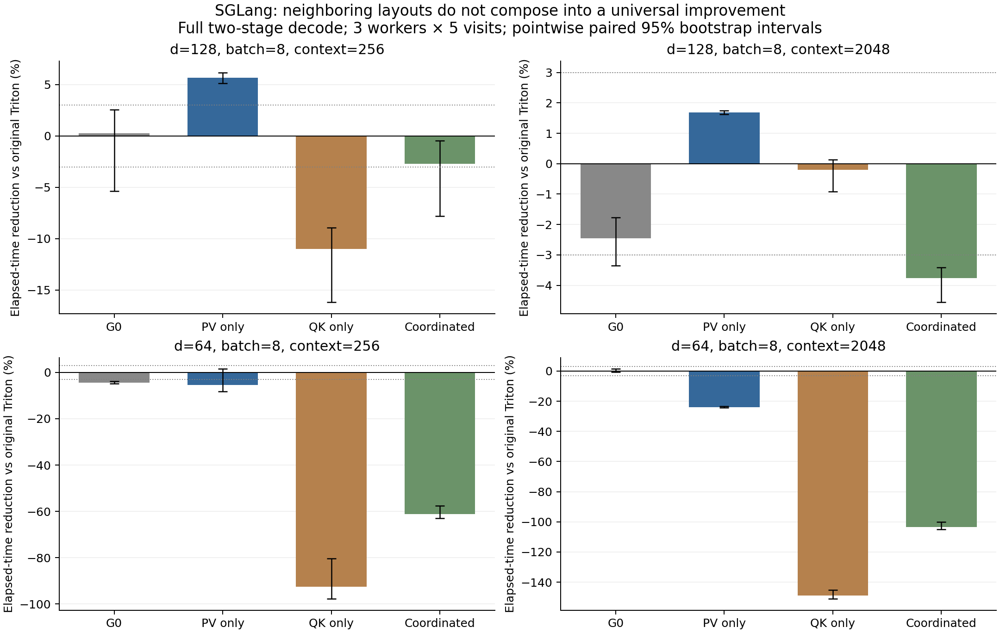

# G4A：SGLang 相邻布局因子实验

本轮检验非 TMA 默认布局的优化空间，没有比较历史编译器版本，不称为性能回归。所有样本、编译产物和 NCU 原始报告均保留；旧 G2/G3 文件逐项 SHA 保护。

## 本轮结果

- d128/context2048 的 PV-only 再现 4.04% 的 G0→GL 收益，但相对原始 Triton 仅 1.69%，低于 3% 实用门槛。
- 让 QK/PV 同时采用目标布局未带来联合优势：同一点相对 G0 为 -1.28%；d64/context2048 的联合改动相对 G0 为 -103.34%。减少邻接转换不是充分条件。
- QK 改动同时改变 K 访问、局部规约和资源分配；完整因子交互随 context 改变，不支持将转换计数乘一个统一延迟来解释整核。精确的依赖关键路径延迟仍未单独识别。

## 固定条件与校验

- Triton `20d9d98fead78c2f65e1b3ba5a7881d86a836dad`；native `fc5f2ad73f9f8c8ab31c3a01b8124329ccec391cdc5dbf2dafb2d42778cf6adb`；H100! / chenmiaoming；复用原 native、ccache 和 kernel cache，native rebuild=0。
- 12 个 CPU 逻辑程序均由真实 CUDA Tensor 的 JIT 调用核对 CUBIN SHA 和 ABI；60 项完整输出、输入不变与 canary 校验通过。
- 3 个独立进程 × 5 visits × 31 samples，8 次预热；实际保存 18,600 个计时样本，覆盖 40 个逻辑条件。精确 CUBIN+ABI+专化+launch context 相同的条件只运行一次并保留别名。
- 时间为单次 CUDA Graph 的 µs；点估计取 worker/visit 中位数的均值，置信区间为 4096 次配对层级 bootstrap。区间为探索性逐项区间，未做多重比较校正；3% 为实用差异参考。
- C02 同列 stage1 与两个原始阶段组成的 decode；C06 是真实源码中的 merge 子内核。尚未测完整服务、框架调度或整个模型。
- 修订前的 CPU 预检误把三个 auxiliary 零整数专化为 constexpr，真实 Tensor JIT gate 拦截了 ABI 不符；失败记录、原协议和原 CPU 产物完整保留。修订后才进行正式计时。

## 预先固定的因子干预

| geometry | PV target | QK target | 固定项 |
|---|---|---|---|
| 64×128/w4 | vec4:n_first | 同一个 vec4:n_first | Q、输出布局；算法/精度/分页/循环/第二阶段 |
| 64×64/w4 | vec1:n_first | 同一个 vec1:n_first | 同上 |

四格：G0=(default PV, default QK)，pv_only=(target PV, default QK)，qk_only=(default PV, target QK)，coordinated=(target PV,target QK)。另保留 untouched upstream。QK 的干预同时影响 K 加载与 QK 规约；不能把因子差分叫作纯布局转换延迟。

## 完整计时矩阵

U 是此组实际绑定的原始 Triton，G0 是与它匹配默认布局的 Gluon。U→G0 的 lowering 差异与 G0→GL 的布局效应分别报告；不得只选较慢的参照。正数表示减少耗时。

| group / batch / context | mode | variant | µs | vs U % [95% CI] | vs G0 % [95% CI] |
|---|---|---|---:|---:|---:|
| C02_n64_d128 / 8 / 256 | decode | coordinated | 16.9259 | -2.72 [-7.78,-0.46] | -3.01 [-8.23,+2.54] |
| C02_n64_d128 / 8 / 256 | decode | gluon_anchor | 16.4309 | +0.28 [-5.36,+2.58] | +0.00 [+0.00,+0.00] |
| C02_n64_d128 / 8 / 256 | decode | pv_only | 15.5456 | +5.66 [+5.11,+6.19] | +5.39 [+3.06,+10.40] |
| C02_n64_d128 / 8 / 256 | decode | qk_only | 18.2869 | -10.98 [-16.19,-8.91] | -11.30 [-12.18,-10.14] |
| C02_n64_d128 / 8 / 256 | decode | upstream | 16.4779 | +0.00 [+0.00,+0.00] | -0.29 [-2.65,+5.09] |
| C02_n64_d128 / 8 / 256 | stage1 | coordinated | 14.2677 | -3.27 [-9.23,-0.83] | -5.54 [-11.68,-3.02] |
| C02_n64_d128 / 8 / 256 | stage1 | gluon_anchor | 13.5189 | +2.15 [+1.50,+2.71] | +0.00 [+0.00,+0.00] |
| C02_n64_d128 / 8 / 256 | stage1 | pv_only | 12.9088 | +6.56 [+6.10,+6.99] | +4.51 [+4.09,+4.95] |
| C02_n64_d128 / 8 / 256 | stage1 | qk_only | 15.6672 | -13.40 [-19.88,-10.75] | -15.89 [-22.43,-13.44] |
| C02_n64_d128 / 8 / 256 | stage1 | upstream | 13.8155 | +0.00 [+0.00,+0.00] | -2.19 [-2.78,-1.52] |
| C02_n64_d128 / 8 / 2048 | decode | coordinated | 108.3264 | -3.76 [-4.56,-3.41] | -1.28 [-1.83,-0.51] |
| C02_n64_d128 / 8 / 2048 | decode | gluon_anchor | 106.9589 | -2.45 [-3.34,-1.77] | +0.00 [+0.00,+0.00] |
| C02_n64_d128 / 8 / 2048 | decode | pv_only | 102.6411 | +1.69 [+1.62,+1.75] | +4.04 [+3.37,+4.88] |
| C02_n64_d128 / 8 / 2048 | decode | qk_only | 104.6080 | -0.20 [-0.92,+0.13] | +2.20 [+1.69,+2.84] |
| C02_n64_d128 / 8 / 2048 | decode | upstream | 104.4011 | +0.00 [+0.00,+0.00] | +2.39 [+1.74,+3.24] |
| C02_n64_d128 / 8 / 2048 | stage1 | coordinated | 104.6997 | -3.40 [-3.81,-2.58] | -1.24 [-1.80,-0.77] |
| C02_n64_d128 / 8 / 2048 | stage1 | gluon_anchor | 103.4176 | -2.14 [-2.66,-1.46] | +0.00 [+0.00,+0.00] |
| C02_n64_d128 / 8 / 2048 | stage1 | pv_only | 99.4923 | +1.74 [+0.99,+2.51] | +3.80 [+3.36,+4.14] |
| C02_n64_d128 / 8 / 2048 | stage1 | qk_only | 100.9963 | +0.25 [-0.10,+1.03] | +2.34 [+1.95,+2.78] |
| C02_n64_d128 / 8 / 2048 | stage1 | upstream | 101.2523 | +0.00 [+0.00,+0.00] | +2.09 [+1.44,+2.60] |
| C02_n64_d64 / 8 / 256 | decode | coordinated | 19.5776 | -61.23 [-63.08,-57.53] | -54.42 [-55.99,-51.38] |
| C02_n64_d64 / 8 / 256 | decode | gluon_anchor | 12.6784 | -4.41 [-4.89,-3.89] | +0.00 [+0.00,+0.00] |
| C02_n64_d64 / 8 / 256 | decode | pv_only | 12.7979 | -5.39 [-8.12,+1.49] | -0.94 [-3.63,+5.37] |
| C02_n64_d64 / 8 / 256 | decode | qk_only | 23.3877 | -92.60 [-97.81,-80.45] | -84.47 [-88.96,-73.42] |
| C02_n64_d64 / 8 / 256 | decode | upstream | 12.1429 | +0.00 [+0.00,+0.00] | +4.22 [+3.75,+4.66] |
| C02_n64_d64 / 8 / 256 | stage1 | coordinated | 17.0432 | -82.11 [-91.31,-78.54] | -72.77 [-81.48,-69.53] |
| C02_n64_d64 / 8 / 256 | stage1 | gluon_anchor | 9.8645 | -5.40 [-5.83,-4.97] | +0.00 [+0.00,+0.00] |
| C02_n64_d64 / 8 / 256 | stage1 | pv_only | 10.5472 | -12.70 [-21.69,-9.29] | -6.92 [-15.46,-3.48] |
| C02_n64_d64 / 8 / 256 | stage1 | qk_only | 20.8192 | -122.45 [-123.53,-121.35] | -111.05 [-111.87,-109.97] |
| C02_n64_d64 / 8 / 256 | stage1 | upstream | 9.3589 | +0.00 [+0.00,+0.00] | +5.13 [+4.73,+5.51] |
| C02_n64_d64 / 8 / 2048 | decode | coordinated | 113.8624 | -103.45 [-104.95,-100.22] | -103.34 [-103.76,-102.83] |
| C02_n64_d64 / 8 / 2048 | decode | gluon_anchor | 55.9957 | -0.05 [-0.75,+1.34] | +0.00 [+0.00,+0.00] |
| C02_n64_d64 / 8 / 2048 | decode | pv_only | 69.3440 | -23.90 [-24.38,-23.36] | -23.84 [-25.17,-23.11] |
| C02_n64_d64 / 8 / 2048 | decode | qk_only | 139.3515 | -148.99 [-151.05,-145.11] | -148.86 [-149.99,-147.97] |
| C02_n64_d64 / 8 / 2048 | decode | upstream | 55.9659 | +0.00 [+0.00,+0.00] | +0.05 [-1.36,+0.74] |
| C02_n64_d64 / 8 / 2048 | stage1 | coordinated | 110.7669 | -109.26 [-110.84,-108.42] | -108.09 [-109.58,-107.37] |
| C02_n64_d64 / 8 / 2048 | stage1 | gluon_anchor | 53.2309 | -0.56 [-0.69,-0.44] | +0.00 [+0.00,+0.00] |
| C02_n64_d64 / 8 / 2048 | stage1 | pv_only | 66.0715 | -24.82 [-26.33,-24.05] | -24.12 [-25.69,-23.34] |
| C02_n64_d64 / 8 / 2048 | stage1 | qk_only | 135.6864 | -156.34 [-156.88,-155.68] | -154.90 [-155.27,-154.38] |
| C02_n64_d64 / 8 / 2048 | stage1 | upstream | 52.9323 | +0.00 [+0.00,+0.00] | +0.56 [+0.44,+0.69] |

## 因子交互

交互 = coordinated − pv_only − qk_only + G0（µs）。负值表示联合改动比两个独立改动的简单相加更省时；这仍是完整程序的交互，不能直接归因于某条指令。

| geometry / context | mode | interaction µs [95% CI] |
|---|---|---:|
| C02_n64_d128 / 256 | decode | -0.4757 [-0.9216,+0.4117] |
| C02_n64_d128 / 256 | stage1 | -0.7893 [-0.8981,-0.6827] |
| C02_n64_d128 / 2048 | decode | +8.0363 [+7.0848,+9.3995] |
| C02_n64_d128 / 2048 | stage1 | +7.6288 [+7.1829,+8.0192] |
| C02_n64_d64 / 256 | decode | -3.9296 [-4.5568,-2.2379] |
| C02_n64_d64 / 256 | stage1 | -4.4587 [-4.5504,-4.3840] |
| C02_n64_d64 / 2048 | decode | -38.8373 [-39.9515,-38.2195] |
| C02_n64_d64 / 2048 | stage1 | -37.7600 [-38.5813,-37.0029] |

## NCU 动态结构与资源

20 份报告全部在本地 CPU 重新导入，逐项数值/动态指令与远端一致。单 CTA 软件计数使用相同 batch8/context2048 数据的第一个 CTA，包含 8 次 KV 循环；硬件计数为 batch8 的实际 grid。

| variant | regs / q_cap | dynamic SHFL / BAR | shared LD / ST | FADD | global LD instructions |
|---|---|---|---|---:|---:|
| C02_n64_d128:upstream | 83 / 5 | 1984 / 396 | 228 / 204 | 6280 | 784 |
| C02_n64_d128:gluon_anchor | 80 / 6 | 1984 / 600 | 524 / 328 | 6280 | 784 |
| C02_n64_d128:pv_only | 96 / 5 | 1472 / 664 | 844 / 420 | 5768 | 1040 |
| C02_n64_d128:qk_only | 105 / 4 | 3456 / 792 | 588 / 712 | 8040 | 1296 |
| C02_n64_d128:coordinated | 96 / 5 | 2944 / 472 | 332 / 228 | 7528 | 1552 |
| C02_n64_d64:upstream | 56 / 9 | 1664 / 264 | 132 / 136 | 3752 | 400 |
| C02_n64_d64:gluon_anchor | 56 / 9 | 1664 / 280 | 140 / 184 | 3752 | 400 |
| C02_n64_d64:pv_only | 79 / 6 | 672 / 448 | 896 / 224 | 2760 | 1296 |
| C02_n64_d64:qk_only | 175 / 2 | 7232 / 792 | 588 / 1784 | 10312 | 2192 |
| C02_n64_d64:coordinated | 142 / 3 | 6240 / 576 | 480 / 960 | 9320 | 3088 |

| variant | LD WF / CTA | LD BC / CTA | global LD requests / sectors per CTA | achieved occ % | eligible warps/scheduler | issue active % | barrier / short scoreboard / long scoreboard / MIO % |
|---|---:|---:|---|---:|---:|---:|---|
| C02_n64_d128:upstream | 612.13 | 0.13 | 784.00 / 8468.00 | 26.58 | 0.380 | 28.54 | 19.11 / 2.23 / 62.20 / 0.05 |
| C02_n64_d128:gluon_anchor | 944.21 | 32.21 | 784.00 / 8468.00 | 31.40 | 0.410 | 29.36 | 18.53 / 3.63 / 62.73 / 0.20 |
| C02_n64_d128:pv_only | 1456.19 | 32.19 | 1040.00 / 8468.00 | 26.44 | 0.430 | 30.96 | 20.28 / 3.91 / 57.13 / 0.38 |
| C02_n64_d128:qk_only | 1264.26 | 96.26 | 1296.00 / 8724.00 | 23.93 | 0.560 | 39.44 | 18.62 / 10.84 / 42.03 / 0.46 |
| C02_n64_d128:coordinated | 624.16 | 96.16 | 1552.00 / 8724.00 | 26.37 | 0.560 | 37.33 | 17.99 / 9.95 / 46.82 / 0.18 |
| C02_n64_d64:upstream | 325.17 | 1.17 | 400.00 / 4252.00 | 46.56 | 0.440 | 30.16 | 17.45 / 2.95 / 68.17 / 0.26 |
| C02_n64_d64:gluon_anchor | 337.29 | 1.29 | 400.00 / 4252.00 | 47.00 | 0.460 | 31.09 | 17.33 / 3.20 / 67.73 / 0.27 |
| C02_n64_d64:pv_only | 1664.49 | 0.49 | 1296.00 / 4252.00 | 29.71 | 0.510 | 34.69 | 14.26 / 5.81 / 58.84 / 0.34 |
| C02_n64_d64:qk_only | 1328.10 | 192.10 | 2192.00 / 5148.00 | 12.11 | 0.470 | 38.43 | 7.83 / 15.82 / 23.15 / 2.41 |
| C02_n64_d64:coordinated | 736.06 | 0.06 | 3088.00 / 5148.00 | 16.93 | 0.700 | 49.76 | 7.20 / 15.27 / 28.32 / 0.30 |

## 从有效布局到实际执行的源码关联

TTGIR 核对证明所有请求的 K/V/Q/output 布局实际生效（effective_layout_audit.json）。默认与目标若同时用于 QK/PV，对两个规约方向的影响相反：

| geometry | 默认 QK lanes×warps / PV lanes×warps | 联合目标 QK / PV |
|---|---|---|
| 64×128/w4 | 16×1 / 2×4 | 32×1 / 1×4 |
| 64×64/w4 | 8×1 / 4×4 | 32×2 / 1×2 |

以 nvdisasm -gi 的 inline caller 源码行关联 NCU 动态 PC。下表是执行实例数，不是 cycles；compiler motion/fusion 会模糊源码边界。line 71 包含概率布局转换与 PV 合并，不作为裸规约延迟。

| variant | QK line53 FADD / SHFL | PV+prob line71 FADD / SHFL | index conversion line63 LDS |
|---|---|---|---:|
| C02_n64_d128:gluon_anchor | 2816 / 1024 | 2816 / 768 | 0 |
| C02_n64_d128:pv_only | 2816 / 1024 | 2304 / 288 | 128 |
| C02_n64_d128:qk_only | 4096 / 2560 | 2816 / 768 | 64 |
| C02_n64_d128:coordinated | 4096 / 2560 | 2304 / 256 | 0 |
| C02_n64_d64:gluon_anchor | 1280 / 384 | 1952 / 1088 | 0 |
| C02_n64_d64:pv_only | 1280 / 384 | 1056 / 96 | 256 |
| C02_n64_d64:qk_only | 6144 / 6144 | 2080 / 1056 | 32 |
| C02_n64_d64:coordinated | 6144 / 6144 | 1024 / 32 | 0 |

d128 的 PV-only 确实减少了 PV 动态合并与 shuffle；联合布局确实消除了 line63 的 index 重分布，但同时把 QK shuffle 从 1024 增至 2560。d128 联合项的 shared-load WF 比 PV-only 更低、相同 n_regs/q_cap 下却更慢，否定“只要减少 shared 转换就会更快”。这不把不同动态指令按等权相加，也不声称已识别每条依赖的绝对延迟。

## 证据文件与解释边界

- `timing_analysis.json`、`all_timings.csv`：全部条件、worker/visit 中位数与配对区间。`code_audit_v2.json`、`source_correlation_v2/`：真实 TTGIR 加载/规约/转换/输出计划，以及本地 nvdisasm 源码行关联。源码行信息用于定位生成物，不等于串行关键路径耗时。
- `compile_gate_v2.json`、`compiled_payload_v2.zip`：精确执行元数据与二进制；`bind/`、`correctness/`、`timing/` 为 write-once 原始证据。
- NCU 的 instruction、request、sector、wavefront 是不同单位；[NVIDIA Profiling Guide](https://docs.nvidia.com/nsight-compute/ProfilingGuide/) 解释 replay/缓存及计数语义。
- [NVIDIA Compute Triage](https://docs.nvidia.com/nsight-compute/ComputeTriage/index.html) 要求结合发射、活跃与 eligible warps 解读 stalls，避免由单个百分比推断优化收益。此处不将 BAR 条数乘一个固定延迟，也不把多项指令数加成总时间。
- [CUDA Best Practices](https://docs.nvidia.com/cuda/cuda-c-best-practices-guide/) 的合并访存原则支持按实际 sector 而非逻辑 vec 判断流量；q_cap 与实际 occupancy 分别报告。
- 文档查阅日 2026-10-21；collector 与本地重导入版本记录在证据中。没有改 C++、训练新 cost model 或创建 PR。
