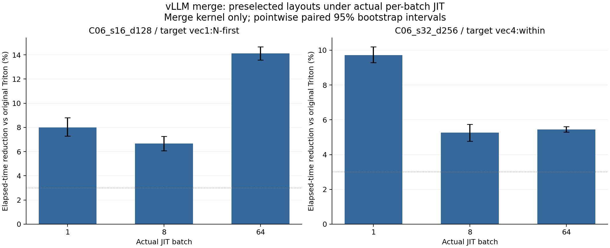

# G4B：实际调用 JIT 与旧 B4 编译绑定

本轮检验非 TMA 默认布局的优化空间，没有比较历史编译器版本，不称为性能回归。所有样本、编译产物和 NCU 原始报告均保留；旧 G2/G3 文件逐项 SHA 保护。

## 本轮结果

- 30 个主内核 actual/B4 绑定比较中 24 个 CUBIN 相同；6 个不同项均为 C06 batch1（num_seqs=1，运行参数从 11 降到 10）。4 个 SGLang 第二阶段与旧 B4 CUBIN 也全部相同。
- batch1 专化本身的六个配对时间变化均不足 3%；保留其正负方向及全部区间，不把源码/JIT 变化本身当作实际收益。
- C06 s16d128 的预选 vec1 在 actual batch=1/8/64 下，相对 G0 分别为 5.47% / 5.82% / 12.48%。C06 s32d256 的目标布局相对 G0 均不足 1%，其对 U 的收益主要是 Gluon 桥接差异，不能归为新布局收益。
- 本组新增计时和实际 JIT 证据，未新增 NCU。旧 NCU 只在二进制与 workload/launch context 均一致时复用；不把 B8 缓存/占用计数外推给 B1/B64。C06 s16 表示 NUM_SEGMENTS_PER_SEQ=16，merge 逻辑矩阵为 16×128；实际分段掩码保持原始语义。

## 固定条件与校验

- Triton `20d9d98fead78c2f65e1b3ba5a7881d86a836dad`；native `fc5f2ad73f9f8c8ab31c3a01b8124329ccec391cdc5dbf2dafb2d42778cf6adb`；H100! / chenmiaoming；复用原 native、ccache 和 kernel cache，native rebuild=0。
- 34 个 CPU 逻辑程序均由真实 CUDA Tensor 的 JIT 调用核对 CUBIN SHA 和 ABI；180 项完整输出、输入不变与 canary 校验通过。
- 3 个独立进程 × 5 visits × 31 samples，8 次预热；实际保存 22,320 个计时样本，覆盖 84 个逻辑条件。精确 CUBIN+ABI+专化+launch context 相同的条件只运行一次并保留别名。
- 时间为单次 CUDA Graph 的 µs；点估计取 worker/visit 中位数的均值，置信区间为 4096 次配对层级 bootstrap。区间为探索性逐项区间，未做多重比较校正；3% 为实用差异参考。
- C02 同列 stage1 与两个原始阶段组成的 decode；C06 是真实源码中的 merge 子内核。尚未测完整服务、框架调度或整个模型。
- 修订前的 CPU 预检误把三个 auxiliary 零整数专化为 constexpr，真实 Tensor JIT gate 拦截了 ABI 不符；失败记录、原协议和原 CPU 产物完整保留。修订后才进行正式计时。

## 实际专化与旧绑定的边界

每个 batch/context 分别在原始入口上 JIT；G0 从该入口实际 TTGIR 提取默认布局。目标布局在新数据前已固定：C06 s16d128=vec1:n_first，C06 s32d256=vec4:within，C02 d128=vec4:n_first，C02 d64=vec1:n_first。新 JIT 与冻结 G2 的 B4 二进制在同一工作负载/worker 上配对计时。

| binding group | variant | actual / B4 identical CUBIN | actual specialized runtime values | actual runtime args / B4 |
|---|---|---|---|---|
| C06_s16_d128_b1_l8192 | upstream | False | `{'num_seqs': 1}` | 10 / 11 |
| C06_s16_d128_b1_l8192 | gluon_anchor | False | `{'num_seqs': 1}` | 10 / 11 |
| C06_s16_d128_b1_l8192 | target | False | `{'num_seqs': 1}` | 10 / 11 |
| C06_s16_d128_b8_l8192 | upstream | True | `{}` | 11 / 11 |
| C06_s16_d128_b8_l8192 | gluon_anchor | True | `{}` | 11 / 11 |
| C06_s16_d128_b8_l8192 | target | True | `{}` | 11 / 11 |
| C06_s16_d128_b64_l8192 | upstream | True | `{}` | 11 / 11 |
| C06_s16_d128_b64_l8192 | gluon_anchor | True | `{}` | 11 / 11 |
| C06_s16_d128_b64_l8192 | target | True | `{}` | 11 / 11 |
| C06_s32_d256_b1_l8192 | upstream | False | `{'num_seqs': 1}` | 10 / 11 |
| C06_s32_d256_b1_l8192 | gluon_anchor | False | `{'num_seqs': 1}` | 10 / 11 |
| C06_s32_d256_b1_l8192 | target | False | `{'num_seqs': 1}` | 10 / 11 |
| C06_s32_d256_b8_l8192 | upstream | True | `{}` | 11 / 11 |
| C06_s32_d256_b8_l8192 | gluon_anchor | True | `{}` | 11 / 11 |
| C06_s32_d256_b8_l8192 | target | True | `{}` | 11 / 11 |
| C06_s32_d256_b64_l8192 | upstream | True | `{}` | 11 / 11 |
| C06_s32_d256_b64_l8192 | gluon_anchor | True | `{}` | 11 / 11 |
| C06_s32_d256_b64_l8192 | target | True | `{}` | 11 / 11 |
| C02_n64_d128_b1_l256 | upstream | True | `{}` | 25 / 25 |
| C02_n64_d128_b1_l256 | gluon_anchor | True | `{}` | 25 / 25 |
| C02_n64_d128_b1_l256 | target | True | `{}` | 25 / 25 |
| C02_n64_d128_b8_l2048 | upstream | True | `{}` | 25 / 25 |
| C02_n64_d128_b8_l2048 | gluon_anchor | True | `{}` | 25 / 25 |
| C02_n64_d128_b8_l2048 | target | True | `{}` | 25 / 25 |
| C02_n64_d64_b1_l256 | upstream | True | `{}` | 25 / 25 |
| C02_n64_d64_b1_l256 | gluon_anchor | True | `{}` | 25 / 25 |
| C02_n64_d64_b1_l256 | target | True | `{}` | 25 / 25 |
| C02_n64_d64_b8_l2048 | upstream | True | `{}` | 25 / 25 |
| C02_n64_d64_b8_l2048 | gluon_anchor | True | `{}` | 25 / 25 |
| C02_n64_d64_b8_l2048 | target | True | `{}` | 25 / 25 |

二进制相同的结果是有效的零结果。CUBIN 不同也只证明生成物发生变化，是否影响时间见配对区间；不自动认定为优化。原始阶段 2 保持源码/算法/配置，实际 JIT 与 B4 的阶段 2 SHA 单独检查。

## 完整计时矩阵

U 是此组实际绑定的原始 Triton，G0 是与它匹配默认布局的 Gluon。U→G0 的 lowering 差异与 G0→GL 的布局效应分别报告；不得只选较慢的参照。正数表示减少耗时。

| group / batch / context | mode | variant | µs | vs U % [95% CI] | vs G0 % [95% CI] |
|---|---|---|---:|---:|---:|
| C02_n64_d128_b1_l256 / 1 / 256 | decode | actual:gluon_anchor | 9.4272 | +1.41 [+0.89,+1.94] | +0.00 [+0.00,+0.00] |
| C02_n64_d128_b1_l256 / 1 / 256 | decode | actual:target | 9.3845 | +1.85 [+1.39,+2.42] | +0.45 [-0.07,+0.93] |
| C02_n64_d128_b1_l256 / 1 / 256 | decode | actual:upstream | 9.5616 | +0.00 [+0.00,+0.00] | -1.43 [-1.97,-0.90] |
| C02_n64_d128_b1_l256 / 1 / 256 | decode | old_B4:gluon_anchor | 9.4272 | +1.41 [+0.89,+1.94] | +0.00 [+0.00,+0.00] |
| C02_n64_d128_b1_l256 / 1 / 256 | decode | old_B4:target | 9.3845 | +1.85 [+1.39,+2.42] | +0.45 [-0.07,+0.93] |
| C02_n64_d128_b1_l256 / 1 / 256 | decode | old_B4:upstream | 9.5616 | +0.00 [+0.00,+0.00] | -1.43 [-1.97,-0.90] |
| C02_n64_d128_b1_l256 / 1 / 256 | stage1 | actual:gluon_anchor | 7.0059 | +3.38 [+2.83,+4.01] | +0.00 [+0.00,+0.00] |
| C02_n64_d128_b1_l256 / 1 / 256 | stage1 | actual:target | 7.0187 | +3.21 [+2.66,+3.67] | -0.18 [-0.95,+0.45] |
| C02_n64_d128_b1_l256 / 1 / 256 | stage1 | actual:upstream | 7.2512 | +0.00 [+0.00,+0.00] | -3.50 [-4.18,-2.92] |
| C02_n64_d128_b1_l256 / 1 / 256 | stage1 | old_B4:gluon_anchor | 7.0059 | +3.38 [+2.83,+4.01] | +0.00 [+0.00,+0.00] |
| C02_n64_d128_b1_l256 / 1 / 256 | stage1 | old_B4:target | 7.0187 | +3.21 [+2.66,+3.67] | -0.18 [-0.95,+0.45] |
| C02_n64_d128_b1_l256 / 1 / 256 | stage1 | old_B4:upstream | 7.2512 | +0.00 [+0.00,+0.00] | -3.50 [-4.18,-2.92] |
| C02_n64_d128_b8_l2048 / 8 / 2048 | decode | actual:gluon_anchor | 104.3541 | -3.17 [-3.30,-3.01] | +0.00 [+0.00,+0.00] |
| C02_n64_d128_b8_l2048 / 8 / 2048 | decode | actual:target | 99.5648 | +1.57 [+1.48,+1.68] | +4.59 [+4.40,+4.76] |
| C02_n64_d128_b8_l2048 / 8 / 2048 | decode | actual:upstream | 101.1499 | +0.00 [+0.00,+0.00] | +3.07 [+2.93,+3.19] |
| C02_n64_d128_b8_l2048 / 8 / 2048 | decode | old_B4:gluon_anchor | 104.3541 | -3.17 [-3.30,-3.01] | +0.00 [+0.00,+0.00] |
| C02_n64_d128_b8_l2048 / 8 / 2048 | decode | old_B4:target | 99.5648 | +1.57 [+1.48,+1.68] | +4.59 [+4.40,+4.76] |
| C02_n64_d128_b8_l2048 / 8 / 2048 | decode | old_B4:upstream | 101.1499 | +0.00 [+0.00,+0.00] | +3.07 [+2.93,+3.19] |
| C02_n64_d128_b8_l2048 / 8 / 2048 | stage1 | actual:gluon_anchor | 100.5632 | -2.91 [-3.11,-2.69] | +0.00 [+0.00,+0.00] |
| C02_n64_d128_b8_l2048 / 8 / 2048 | stage1 | actual:target | 96.1728 | +1.59 [+1.50,+1.66] | +4.37 [+4.14,+4.55] |
| C02_n64_d128_b8_l2048 / 8 / 2048 | stage1 | actual:upstream | 97.7237 | +0.00 [+0.00,+0.00] | +2.82 [+2.62,+3.02] |
| C02_n64_d128_b8_l2048 / 8 / 2048 | stage1 | old_B4:gluon_anchor | 100.5632 | -2.91 [-3.11,-2.69] | +0.00 [+0.00,+0.00] |
| C02_n64_d128_b8_l2048 / 8 / 2048 | stage1 | old_B4:target | 96.1728 | +1.59 [+1.50,+1.66] | +4.37 [+4.14,+4.55] |
| C02_n64_d128_b8_l2048 / 8 / 2048 | stage1 | old_B4:upstream | 97.7237 | +0.00 [+0.00,+0.00] | +2.82 [+2.62,+3.02] |
| C02_n64_d64_b1_l256 / 1 / 256 | decode | actual:gluon_anchor | 8.8875 | -1.49 [-2.14,-0.86] | +0.00 [+0.00,+0.00] |
| C02_n64_d64_b1_l256 / 1 / 256 | decode | actual:target | 9.0709 | -3.58 [-4.32,-2.80] | -2.06 [-2.66,-1.46] |
| C02_n64_d64_b1_l256 / 1 / 256 | decode | actual:upstream | 8.7573 | +0.00 [+0.00,+0.00] | +1.46 [+0.85,+2.09] |
| C02_n64_d64_b1_l256 / 1 / 256 | decode | old_B4:gluon_anchor | 8.8875 | -1.49 [-2.14,-0.86] | +0.00 [+0.00,+0.00] |
| C02_n64_d64_b1_l256 / 1 / 256 | decode | old_B4:target | 9.0709 | -3.58 [-4.32,-2.80] | -2.06 [-2.66,-1.46] |
| C02_n64_d64_b1_l256 / 1 / 256 | decode | old_B4:upstream | 8.7573 | +0.00 [+0.00,+0.00] | +1.46 [+0.85,+2.09] |
| C02_n64_d64_b1_l256 / 1 / 256 | stage1 | actual:gluon_anchor | 6.5067 | -2.35 [-2.86,-1.91] | +0.00 [+0.00,+0.00] |
| C02_n64_d64_b1_l256 / 1 / 256 | stage1 | actual:target | 6.6240 | -4.19 [-4.68,-3.78] | -1.80 [-2.34,-1.21] |
| C02_n64_d64_b1_l256 / 1 / 256 | stage1 | actual:upstream | 6.3573 | +0.00 [+0.00,+0.00] | +2.30 [+1.87,+2.78] |
| C02_n64_d64_b1_l256 / 1 / 256 | stage1 | old_B4:gluon_anchor | 6.5067 | -2.35 [-2.86,-1.91] | +0.00 [+0.00,+0.00] |
| C02_n64_d64_b1_l256 / 1 / 256 | stage1 | old_B4:target | 6.6240 | -4.19 [-4.68,-3.78] | -1.80 [-2.34,-1.21] |
| C02_n64_d64_b1_l256 / 1 / 256 | stage1 | old_B4:upstream | 6.3573 | +0.00 [+0.00,+0.00] | +2.30 [+1.87,+2.78] |
| C02_n64_d64_b8_l2048 / 8 / 2048 | decode | actual:gluon_anchor | 53.8880 | -0.45 [-0.61,-0.28] | +0.00 [+0.00,+0.00] |
| C02_n64_d64_b8_l2048 / 8 / 2048 | decode | actual:target | 67.4432 | -25.71 [-25.92,-25.52] | -25.15 [-25.37,-24.92] |
| C02_n64_d64_b8_l2048 / 8 / 2048 | decode | actual:upstream | 53.6491 | +0.00 [+0.00,+0.00] | +0.44 [+0.28,+0.61] |
| C02_n64_d64_b8_l2048 / 8 / 2048 | decode | old_B4:gluon_anchor | 53.8880 | -0.45 [-0.61,-0.28] | +0.00 [+0.00,+0.00] |
| C02_n64_d64_b8_l2048 / 8 / 2048 | decode | old_B4:target | 67.4432 | -25.71 [-25.92,-25.52] | -25.15 [-25.37,-24.92] |
| C02_n64_d64_b8_l2048 / 8 / 2048 | decode | old_B4:upstream | 53.6491 | +0.00 [+0.00,+0.00] | +0.44 [+0.28,+0.61] |
| C02_n64_d64_b8_l2048 / 8 / 2048 | stage1 | actual:gluon_anchor | 51.1851 | -0.40 [-0.57,-0.23] | +0.00 [+0.00,+0.00] |
| C02_n64_d64_b8_l2048 / 8 / 2048 | stage1 | actual:target | 64.1152 | -25.76 [-26.03,-25.54] | -25.26 [-25.47,-25.04] |
| C02_n64_d64_b8_l2048 / 8 / 2048 | stage1 | actual:upstream | 50.9824 | +0.00 [+0.00,+0.00] | +0.40 [+0.23,+0.57] |
| C02_n64_d64_b8_l2048 / 8 / 2048 | stage1 | old_B4:gluon_anchor | 51.1851 | -0.40 [-0.57,-0.23] | +0.00 [+0.00,+0.00] |
| C02_n64_d64_b8_l2048 / 8 / 2048 | stage1 | old_B4:target | 64.1152 | -25.76 [-26.03,-25.54] | -25.26 [-25.47,-25.04] |
| C02_n64_d64_b8_l2048 / 8 / 2048 | stage1 | old_B4:upstream | 50.9824 | +0.00 [+0.00,+0.00] | +0.40 [+0.23,+0.57] |
| C06_s16_d128_b1_l8192 / 1 / 8192 | merge | actual:gluon_anchor | 5.8944 | +2.68 [+2.05,+3.27] | +0.00 [+0.00,+0.00] |
| C06_s16_d128_b1_l8192 / 1 / 8192 | merge | actual:target | 5.5723 | +8.00 [+7.29,+8.81] | +5.47 [+4.73,+6.12] |
| C06_s16_d128_b1_l8192 / 1 / 8192 | merge | actual:upstream | 6.0565 | +0.00 [+0.00,+0.00] | -2.75 [-3.38,-2.09] |
| C06_s16_d128_b1_l8192 / 1 / 8192 | merge | old_B4:gluon_anchor | 5.9712 | +1.41 [+0.91,+1.91] | -1.30 [-1.85,-0.78] |
| C06_s16_d128_b1_l8192 / 1 / 8192 | merge | old_B4:target | 5.6427 | +6.83 [+6.20,+7.46] | +4.27 [+3.50,+5.04] |
| C06_s16_d128_b1_l8192 / 1 / 8192 | merge | old_B4:upstream | 6.1333 | -1.27 [-1.64,-0.91] | -4.05 [-4.52,-3.46] |
| C06_s16_d128_b64_l8192 / 64 / 8192 | merge | actual:gluon_anchor | 9.8837 | +1.88 [+1.43,+2.40] | +0.00 [+0.00,+0.00] |
| C06_s16_d128_b64_l8192 / 64 / 8192 | merge | actual:target | 8.6507 | +14.13 [+13.58,+14.68] | +12.48 [+11.98,+13.02] |
| C06_s16_d128_b64_l8192 / 64 / 8192 | merge | actual:upstream | 10.0736 | +0.00 [+0.00,+0.00] | -1.92 [-2.46,-1.45] |
| C06_s16_d128_b64_l8192 / 64 / 8192 | merge | old_B4:gluon_anchor | 9.8837 | +1.88 [+1.43,+2.40] | +0.00 [+0.00,+0.00] |
| C06_s16_d128_b64_l8192 / 64 / 8192 | merge | old_B4:target | 8.6507 | +14.13 [+13.58,+14.68] | +12.48 [+11.98,+13.02] |
| C06_s16_d128_b64_l8192 / 64 / 8192 | merge | old_B4:upstream | 10.0736 | +0.00 [+0.00,+0.00] | -1.92 [-2.46,-1.45] |
| C06_s16_d128_b8_l8192 / 8 / 8192 | merge | actual:gluon_anchor | 6.5643 | +0.90 [+0.52,+1.38] | +0.00 [+0.00,+0.00] |
| C06_s16_d128_b8_l8192 / 8 / 8192 | merge | actual:target | 6.1824 | +6.67 [+6.08,+7.26] | +5.82 [+5.09,+6.50] |
| C06_s16_d128_b8_l8192 / 8 / 8192 | merge | actual:upstream | 6.6240 | +0.00 [+0.00,+0.00] | -0.91 [-1.40,-0.52] |
| C06_s16_d128_b8_l8192 / 8 / 8192 | merge | old_B4:gluon_anchor | 6.5643 | +0.90 [+0.52,+1.38] | +0.00 [+0.00,+0.00] |
| C06_s16_d128_b8_l8192 / 8 / 8192 | merge | old_B4:target | 6.1824 | +6.67 [+6.08,+7.26] | +5.82 [+5.09,+6.50] |
| C06_s16_d128_b8_l8192 / 8 / 8192 | merge | old_B4:upstream | 6.6240 | +0.00 [+0.00,+0.00] | -0.91 [-1.40,-0.52] |
| C06_s32_d256_b1_l8192 / 1 / 8192 | merge | actual:gluon_anchor | 6.0544 | +9.82 [+9.28,+10.33] | +0.00 [+0.00,+0.00] |
| C06_s32_d256_b1_l8192 / 1 / 8192 | merge | actual:target | 6.0608 | +9.72 [+9.29,+10.20] | -0.11 [-0.70,+0.42] |
| C06_s32_d256_b1_l8192 / 1 / 8192 | merge | actual:upstream | 6.7136 | +0.00 [+0.00,+0.00] | -10.89 [-11.51,-10.23] |
| C06_s32_d256_b1_l8192 / 1 / 8192 | merge | old_B4:gluon_anchor | 6.0971 | +9.18 [+8.26,+9.87] | -0.70 [-1.80,+0.39] |
| C06_s32_d256_b1_l8192 / 1 / 8192 | merge | old_B4:target | 6.1291 | +8.71 [+8.04,+9.32] | -1.23 [-2.11,-0.49] |
| C06_s32_d256_b1_l8192 / 1 / 8192 | merge | old_B4:upstream | 6.6368 | +1.14 [+0.48,+1.81] | -9.62 [-10.45,-8.90] |
| C06_s32_d256_b64_l8192 / 64 / 8192 | merge | actual:gluon_anchor | 29.5893 | +5.36 [+5.11,+5.54] | +0.00 [+0.00,+0.00] |
| C06_s32_d256_b64_l8192 / 64 / 8192 | merge | actual:target | 29.5616 | +5.45 [+5.30,+5.60] | +0.09 [-0.10,+0.30] |
| C06_s32_d256_b64_l8192 / 64 / 8192 | merge | actual:upstream | 31.2640 | +0.00 [+0.00,+0.00] | -5.66 [-5.86,-5.38] |
| C06_s32_d256_b64_l8192 / 64 / 8192 | merge | old_B4:gluon_anchor | 29.5893 | +5.36 [+5.11,+5.54] | +0.00 [+0.00,+0.00] |
| C06_s32_d256_b64_l8192 / 64 / 8192 | merge | old_B4:target | 29.5616 | +5.45 [+5.30,+5.60] | +0.09 [-0.10,+0.30] |
| C06_s32_d256_b64_l8192 / 64 / 8192 | merge | old_B4:upstream | 31.2640 | +0.00 [+0.00,+0.00] | -5.66 [-5.86,-5.38] |
| C06_s32_d256_b8_l8192 / 8 / 8192 | merge | actual:gluon_anchor | 7.2939 | +4.68 [+4.20,+5.17] | +0.00 [+0.00,+0.00] |
| C06_s32_d256_b8_l8192 / 8 / 8192 | merge | actual:target | 7.2491 | +5.27 [+4.77,+5.74] | +0.61 [+0.15,+1.17] |
| C06_s32_d256_b8_l8192 / 8 / 8192 | merge | actual:upstream | 7.6523 | +0.00 [+0.00,+0.00] | -4.91 [-5.45,-4.38] |
| C06_s32_d256_b8_l8192 / 8 / 8192 | merge | old_B4:gluon_anchor | 7.2939 | +4.68 [+4.20,+5.17] | +0.00 [+0.00,+0.00] |
| C06_s32_d256_b8_l8192 / 8 / 8192 | merge | old_B4:target | 7.2491 | +5.27 [+4.77,+5.74] | +0.61 [+0.15,+1.17] |
| C06_s32_d256_b8_l8192 / 8 / 8192 | merge | old_B4:upstream | 7.6523 | +0.00 [+0.00,+0.00] | -4.91 [-5.45,-4.38] |

## actual JIT 相对 B4 replay 的配对变化

| group | mode | variant | actual gain vs B4 % [95% CI] |
|---|---|---|---:|
| C02_n64_d128_b1_l256 | decode | upstream actual-vs-B4 | +0.00 [+0.00,+0.00] |
| C02_n64_d128_b1_l256 | decode | gluon_anchor actual-vs-B4 | +0.00 [+0.00,+0.00] |
| C02_n64_d128_b1_l256 | decode | target actual-vs-B4 | +0.00 [+0.00,+0.00] |
| C02_n64_d128_b1_l256 | stage1 | upstream actual-vs-B4 | +0.00 [+0.00,+0.00] |
| C02_n64_d128_b1_l256 | stage1 | gluon_anchor actual-vs-B4 | +0.00 [+0.00,+0.00] |
| C02_n64_d128_b1_l256 | stage1 | target actual-vs-B4 | +0.00 [+0.00,+0.00] |
| C02_n64_d128_b8_l2048 | decode | upstream actual-vs-B4 | +0.00 [+0.00,+0.00] |
| C02_n64_d128_b8_l2048 | decode | gluon_anchor actual-vs-B4 | +0.00 [+0.00,+0.00] |
| C02_n64_d128_b8_l2048 | decode | target actual-vs-B4 | +0.00 [+0.00,+0.00] |
| C02_n64_d128_b8_l2048 | stage1 | upstream actual-vs-B4 | +0.00 [+0.00,+0.00] |
| C02_n64_d128_b8_l2048 | stage1 | gluon_anchor actual-vs-B4 | +0.00 [+0.00,+0.00] |
| C02_n64_d128_b8_l2048 | stage1 | target actual-vs-B4 | +0.00 [+0.00,+0.00] |
| C02_n64_d64_b1_l256 | decode | upstream actual-vs-B4 | +0.00 [+0.00,+0.00] |
| C02_n64_d64_b1_l256 | decode | gluon_anchor actual-vs-B4 | +0.00 [+0.00,+0.00] |
| C02_n64_d64_b1_l256 | decode | target actual-vs-B4 | +0.00 [+0.00,+0.00] |
| C02_n64_d64_b1_l256 | stage1 | upstream actual-vs-B4 | +0.00 [+0.00,+0.00] |
| C02_n64_d64_b1_l256 | stage1 | gluon_anchor actual-vs-B4 | +0.00 [+0.00,+0.00] |
| C02_n64_d64_b1_l256 | stage1 | target actual-vs-B4 | +0.00 [+0.00,+0.00] |
| C02_n64_d64_b8_l2048 | decode | upstream actual-vs-B4 | +0.00 [+0.00,+0.00] |
| C02_n64_d64_b8_l2048 | decode | gluon_anchor actual-vs-B4 | +0.00 [+0.00,+0.00] |
| C02_n64_d64_b8_l2048 | decode | target actual-vs-B4 | +0.00 [+0.00,+0.00] |
| C02_n64_d64_b8_l2048 | stage1 | upstream actual-vs-B4 | +0.00 [+0.00,+0.00] |
| C02_n64_d64_b8_l2048 | stage1 | gluon_anchor actual-vs-B4 | +0.00 [+0.00,+0.00] |
| C02_n64_d64_b8_l2048 | stage1 | target actual-vs-B4 | +0.00 [+0.00,+0.00] |
| C06_s16_d128_b1_l8192 | merge | upstream actual-vs-B4 | +1.25 [+0.91,+1.61] |
| C06_s16_d128_b1_l8192 | merge | gluon_anchor actual-vs-B4 | +1.29 [+0.78,+1.82] |
| C06_s16_d128_b1_l8192 | merge | target actual-vs-B4 | +1.25 [+0.19,+2.32] |
| C06_s16_d128_b64_l8192 | merge | upstream actual-vs-B4 | +0.00 [+0.00,+0.00] |
| C06_s16_d128_b64_l8192 | merge | gluon_anchor actual-vs-B4 | +0.00 [+0.00,+0.00] |
| C06_s16_d128_b64_l8192 | merge | target actual-vs-B4 | +0.00 [+0.00,+0.00] |
| C06_s16_d128_b8_l8192 | merge | upstream actual-vs-B4 | +0.00 [+0.00,+0.00] |
| C06_s16_d128_b8_l8192 | merge | gluon_anchor actual-vs-B4 | +0.00 [+0.00,+0.00] |
| C06_s16_d128_b8_l8192 | merge | target actual-vs-B4 | +0.00 [+0.00,+0.00] |
| C06_s32_d256_b1_l8192 | merge | upstream actual-vs-B4 | -1.16 [-1.85,-0.48] |
| C06_s32_d256_b1_l8192 | merge | gluon_anchor actual-vs-B4 | +0.70 [-0.39,+1.76] |
| C06_s32_d256_b1_l8192 | merge | target actual-vs-B4 | +1.11 [+0.74,+1.62] |
| C06_s32_d256_b64_l8192 | merge | upstream actual-vs-B4 | +0.00 [+0.00,+0.00] |
| C06_s32_d256_b64_l8192 | merge | gluon_anchor actual-vs-B4 | +0.00 [+0.00,+0.00] |
| C06_s32_d256_b64_l8192 | merge | target actual-vs-B4 | +0.00 [+0.00,+0.00] |
| C06_s32_d256_b8_l8192 | merge | upstream actual-vs-B4 | +0.00 [+0.00,+0.00] |
| C06_s32_d256_b8_l8192 | merge | gluon_anchor actual-vs-B4 | +0.00 [+0.00,+0.00] |
| C06_s32_d256_b8_l8192 | merge | target actual-vs-B4 | +0.00 [+0.00,+0.00] |

## 证据文件与解释边界

- `timing_analysis.json`、`all_timings.csv`：全部条件、worker/visit 中位数与配对区间。`code_audit_v2.json`、`source_correlation_v2/`：真实 TTGIR 加载/规约/转换/输出计划，以及本地 nvdisasm 源码行关联。源码行信息用于定位生成物，不等于串行关键路径耗时。
- `compile_gate_v2.json`、`compiled_payload_v2.zip`：精确执行元数据与二进制；`bind/`、`correctness/`、`timing/` 为 write-once 原始证据。
- NCU 的 instruction、request、sector、wavefront 是不同单位；[NVIDIA Profiling Guide](https://docs.nvidia.com/nsight-compute/ProfilingGuide/) 解释 replay/缓存及计数语义。
- [NVIDIA Compute Triage](https://docs.nvidia.com/nsight-compute/ComputeTriage/index.html) 要求结合发射、活跃与 eligible warps 解读 stalls，避免由单个百分比推断优化收益。此处不将 BAR 条数乘一个固定延迟，也不把多项指令数加成总时间。
- [CUDA Best Practices](https://docs.nvidia.com/cuda/cuda-c-best-practices-guide/) 的合并访存原则支持按实际 sector 而非逻辑 vec 判断流量；q_cap 与实际 occupancy 分别报告。
- 文档查阅日 2026-10-21；collector 与本地重导入版本记录在证据中。没有改 C++、训练新 cost model 或创建 PR。
