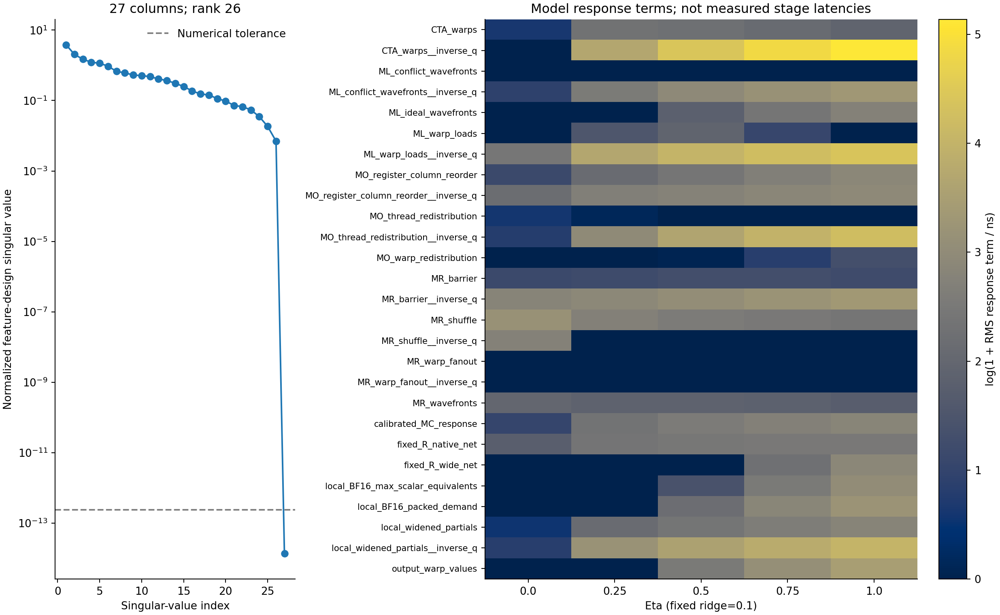
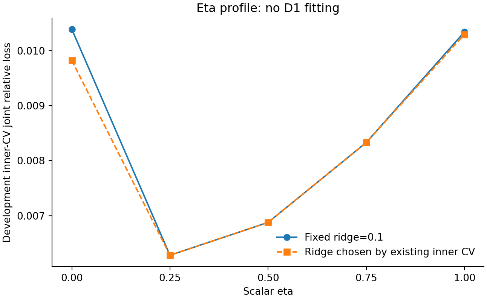
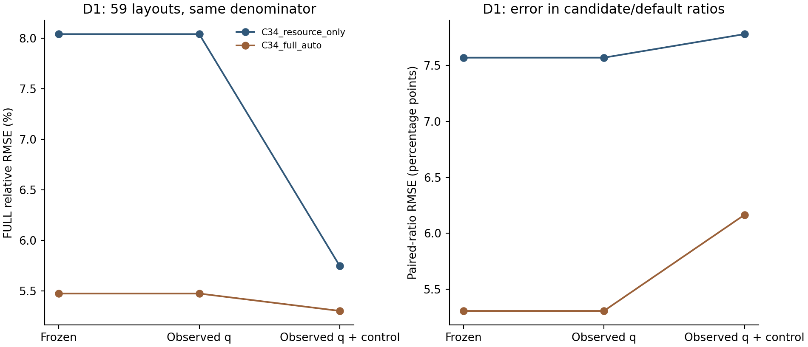
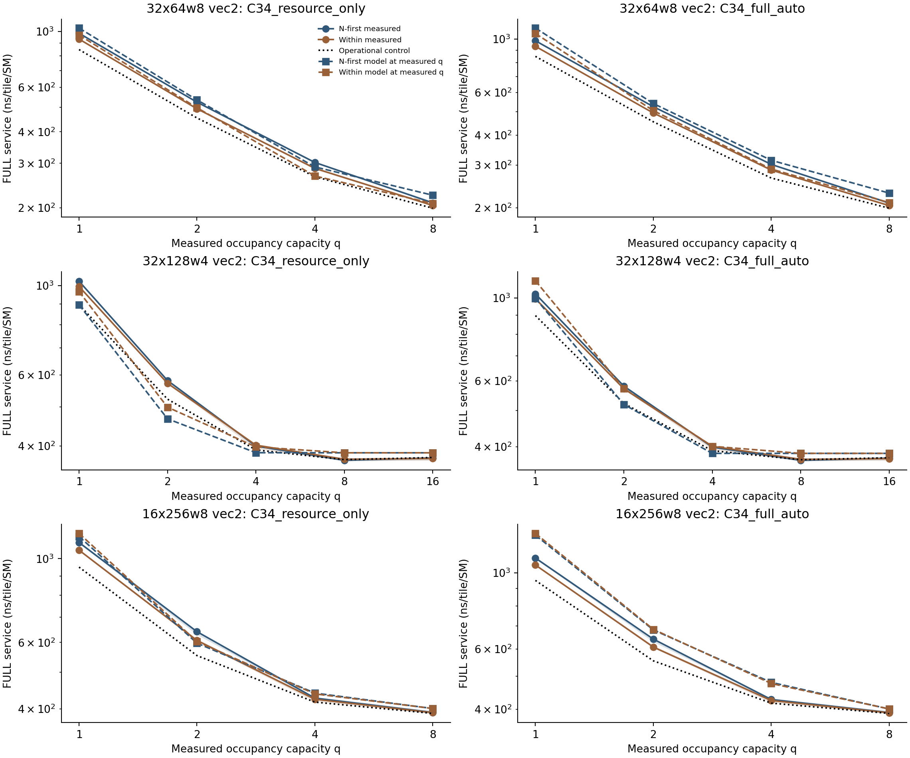

# Stage M1 — 模型可辨识性与机制审计

本轮只做 CPU 事后诊断，没有启动 GPU、重编 Triton、采集新 NCU 或修改旧阶段证据。D1 已经暴露，本报告不产生新的盲测成绩，也不修改冻结选择器。

结果有四点：**MC 预测特征是现有基础特征的精确线性组合；标量 η 的开发集 CV 仍偏好 0.25；已知的 FULL 预测失败不能仅靠真实 q 或 T_control 修复；部分低 q 配对差分连方向也预测错误。** 配对布局的输出转换策略发生变化，目前证据不足以把整核时间差单独归因到 MR。

## 1. 方法与输入边界

- CPU 审计方法在本轮计算前写入 protocol.json，父提交 `33738b43ae8df7823813753bc7e9c405fd0e0c14`；prior_manifest.json 绑定 29000 个已有文件。
- η 剖面只使用九个开发几何。复用 C3.4 原有内层 CV 误差，并按原拟合实现做十次全开发集拟合：五个 η × 固定 ridge/原 CV 选定 ridge。D1 不参与拟合或选参。
- 误差定位采用开发集留一几何模型与 D1 原冻结最终模型；所有系数保持不变。读取同 worker、同 GPU UUID、同几何和精确 q 的控制数据；不插值补造缺失 q。
- q 是 occupancy capacity，不是每个瞬间实际驻留 CTA 数。T_control 是包含 TMA、等待、首行读取和写回的操作对照，不是独立测出的纯传输时间。
- 复现 1080 条 worker 级自然驻留冻结预测，整理 49 组同 vec 布局对，并对六个保留 CUBIN 做本地调试行反汇编。

## 2. 27 列、rank=26 的原因已定位

MC 模型先由 26 个基础特征拟合；FULL 模型再次使用这 26 个特征，并加入 calibrated_MC_response。审计设计点上，MC 的非负截断没有激活，因此：

$$x_{MC}=X_{base}\beta_{MC},\quad A_{FULL}=X_{base}\beta_F+\gamma x_{MC}=X_{base}(\beta_F+\gamma\beta_{MC}).$$

归一化 FULL 特征设计矩阵的秩为 **26/27**。显式合并这条冗余列后，十个 η/ridge 拟合在开发集设计点上的 A_FULL 最大重建误差仅 **2.274e-13 ns**。完整零空间关系、奇异值和合并系数保存在 identifiability.json。

这个结果说明 MC 代理项在本次输入域内没有增加独立表达维度，不能再把“基础特征贡献”和“MC 贡献”解释成两份独立硬件成本。它仍可能通过参数化与 ridge 改变拟合偏好；删除特征后重新训练不保证原预测不变。这里的代数合并仅用于解释，没有发布简化选择器。

固定 ridge=0.1 的五个拟合，其非零活跃列均满列秩；按原 CV 选择 ridge 时，η=1/ridge=1 的 27 个活跃列仍只有 rank=26。完整活跃列秩逐项保存在 identifiability.json，不能把全设计 rank=26 扩大解释为全部有效系数任意或模型完全不可用。非零系数随 η 的变化与输出预测的变化需要分开查看。



右图展示模型响应项 RMS，不是各阶段实测延迟；原 NNLS diagnostic 中 training_rmse_ns 的历史字段名也不表示真实 ns，因为输入已按尺度和配对目标加权。

## 3. η 剖面：有开发集偏好，尚无独立物理识别

| η | 固定 ridge=0.1 的原内层 CV 损失 | 每个 η 的最佳原 CV 损失 | 原 CV 选定 ridge | 活跃列数/秩（固定 ridge） |
|---:|---:|---:|---:|---:|
| 0.00 | 0.0103881 | 0.0098217 | 0.01 | 16/16 |
| 0.25 | 0.0062820 | 0.0062820 | 0.1 | 17/17 |
| 0.50 | 0.0068788 | 0.0068788 | 0.1 | 21/21 |
| 0.75 | 0.0083300 | 0.0083300 | 0.1 | 22/22 |
| 1.00 | 0.0103383 | 0.0102946 | 1.0 | 21/21 |



曲线不是完全平坦：在预注册的离散标量网格上 η=0.25 最好。不能宣布 η 毫无数据约束；也不能把这一偏好升级为“硬件恰好重叠 25%”。A_FULL 与 η 共同拟合，基础特征还存在强相关；完整响应函数仍需独立干预来识别。该曲线是交叉验证目标，不是 profile-likelihood 置信区间。

## 4. 冻结响应模型的四组合误差定位

static：原 q 与原控制预测；measured_q：仅换成真实容量；measured_control：仅换成预测 q 处的同 worker 实测控制；both：同时换成真实 q 与该 q 的实测控制。每次均重新计算相同冻结响应公式，不重新拟合系数。

### 同分母的 D1 自然驻留比较

| 模型 | 输入 | 候选数 | FULL 相对 RMSE | 配对比例 RMSE pp |
|---|---|---:|---:|---:|
| C34_resource_only | static | 59 | 8.042% | 7.570 |
| C34_resource_only | measured_q | 59 | 8.042% | 7.570 |
| C34_resource_only | measured_q_and_control | 59 | 5.746% | 7.780 |
| C34_full_auto | static | 59 | 5.473% | 5.307 |
| C34_full_auto | measured_q | 59 | 5.473% | 5.307 |
| C34_full_auto | measured_q_and_control | 59 | 5.301% | 6.166 |
| C33 | static | 59 | 8.042% | 7.570 |
| C33 | measured_q | 59 | 8.042% | 7.570 |
| C33 | measured_q_and_control | 59 | 5.746% | 7.780 |



真实 q 替换在 D1 自然点上没有改善这两个模型的时间预测；这不等价于资源模型正确，而是当前这些响应分支对相应 q 误差不敏感。真实控制可改善绝对时间误差，但配对比例误差反而增加，说明预测公共尺度与预测布局间收益是不同问题，输入误差也可能互相补偿。

### 四组合均可计算的共同支持域

| 模型 / 数据 | 四组合共同候选条件数 | 原 FULL RMSE | 真实 q | 真实控制 | 两者 |
|---|---:|---:|---:|---:|---:|
| C34_resource_only / development | 59 | 7.567% | 7.567% | 6.854% | 6.854% |
| C34_resource_only / D1 | 40 | 9.744% | 9.744% | 6.976% | 6.976% |
| C34_full_auto / development | 59 | 7.826% | 7.826% | 7.208% | 7.208% |
| C34_full_auto / D1 | 40 | 6.613% | 6.613% | 6.436% | 6.436% |

D1 的 measured_control 单独替换只覆盖 40/59 候选：其余 19 个候选的静态 q 未在原控制测量中出现。它的分母不能直接与 59 候选比较。全部自然/受控 q、共同支持域与可用域指标在 tables/substitution_metrics.csv；逐 worker 四组合与交互项在 pipeline.json。替换只是计算诊断，不是因果归因。

### 16×256/w8：已暴露的失败点

| 模型 / 输入 | 默认预测 ns | vec2:within 预测 ns | 预测收益 |
|---|---:|---:|---:|
| C34_resource_only / static | 496.116 | 400.924 | 19.19% |
| C34_resource_only / measured_q | 496.116 | 400.924 | 19.19% |
| C34_resource_only / measured_q_and_control | 487.347 | 389.232 | 20.13% |
| C34_full_auto / static | 456.540 | 400.924 | 12.18% |
| C34_full_auto / measured_q | 456.540 | 400.924 | 12.18% |
| C34_full_auto / measured_q_and_control | 456.540 | 389.232 | 14.74% |

实测默认约 396.65 ns、vec2:within 约 390.84 ns，worker 配对收益 1.53%。真实 q 和控制均代入后，冻结模型仍无法闭合布局差分；剩余问题在 FULL 响应/包络及其特征表征中，不能继续只归咎于 q 或控制外推。

## 5. 配对布局：静态匹配不等于单一机制干预

| 几何 / vec2 | 静态 ML 是否相同 | n_regs NF/within | 自然 q | 整核 SHFL | 整核 BAR.SYNC | 整核 MAX |
|---|---|---|---|---|---|---|
| 32x64w8 | True | 17/14 | 8/8 | 64/48 | 48/32 | 64/72 |
| 32x128w4 | False | 23/24 | 16/16 | 8/16 | 32/8 | 48/72 |
| 16x256w8 | False | 20/16 | 8/8 | 16/32 | 64/16 | 56/80 |

32×64/w8 vec2 的静态 ML 理想波前均为 32、bank conflicts 均为 0，p 均为 4，局部 max 标量等价需求相同。它确实是有价值的通信拓扑对照，但整核 SHFL/MAX 与输出转换仍变化，不能把整个时间差直接称为纯 MR 成本。

### 已保留机器码的源行归属

| 程序 | PC 未对齐站点 | 归到 MO 源行的 SHFL / BAR / LDS / STS |
|---|---:|---|
| M32_N128_w4:vec2:n_first:ONE_FULL | 0 | 0 / 8 / 4 / 8 |
| M32_N128_w4:vec2:within:ONE_FULL | 0 | 8 / 0 / 0 / 0 |
| M32_N64_w8:vec2:n_first:ONE_FULL | 0 | 16 / 0 / 0 / 0 |
| M32_N64_w8:vec2:within:ONE_FULL | 0 | 0 / 16 / 2 / 8 |
| M16_N256_w8:vec2:n_first:ONE_FULL | 0 | 0 / 16 / 8 / 16 |
| M16_N256_w8:vec2:within:ONE_FULL | 0 | 16 / 0 / 0 / 0 |

32×64/w8 vec2：N-first 至少有 16 条动态 warp SHFL 归到输出转换；within 至少有 16 BAR、2 LDS、8 STS 归到输出转换。两者的粗粒度 MO 静态布尔标记相同，但实际输出转换策略不同。这个差别是当前 MO 需求特征没有显式区分的内容。

PC 与原 CUBIN 地址均对齐，但调试源行并不完整：复用 explicit 内核把 load/cast/max 分行；one_pass 把三者放在同一源行，部分 helper 指令没有可归属的源位置。本报告保留 joint_ML_local_MR 与 unattributed，没有把整核 shared 波前硬拆成 ML 或 MR，也没有把动态 warp 指令数当作时间。

## 6. 相同二进制的受控 q 曲线

以下均为已测 loop-free FULL；实线/阴影是三 worker 中位数/范围，虚线是冻结模型在实测容量 q 上的响应。控制与同 q 的 FULL 配对，不重新引入长循环脚手架。



| 几何 / vec2 | q | within−NF 实测 ns | within 实测收益 | 标量模型在真实 q 的预测差 ns | auto 模型在真实 q 的预测差 ns |
|---|---:|---:|---:|---:|---:|
| 32x64w8 | 1 | -51.079 | 5.19% | -64.248 | -56.127 |
| 32x64w8 | 2 | -30.680 | 5.85% | -36.826 | -35.500 |
| 32x64w8 | 4 | -17.016 | 5.61% | -23.115 | -25.186 |
| 32x64w8 | 8 | -4.866 | 2.33% | -16.260 | -20.030 |
| 32x128w4 | 1 | -31.260 | 3.04% | 70.225 | 113.761 |
| 32x128w4 | 2 | -9.217 | 1.59% | 32.082 | 53.642 |
| 32x128w4 | 4 | 0.516 | -0.13% | 13.010 | 17.059 |
| 32x128w4 | 8 | 0.129 | -0.04% | 0.000 | 0.000 |
| 32x128w4 | 16 | -1.225 | 0.33% | 0.000 | 0.000 |
| 16x256w8 | 1 | -50.467 | 4.57% | 21.569 | 15.011 |
| 16x256w8 | 2 | -30.809 | 4.80% | 5.742 | 2.628 |
| 16x256w8 | 4 | -4.770 | 1.11% | -2.171 | -3.563 |
| 16x256w8 | 8 | -0.645 | 0.16% | 0.000 | 0.000 |

这组配对响应存在方向性反例：32×128/w4 在 q=1 时，标量模型预测 within 慢 70.23 ns，实测却快 31.26 ns；16×256/w8 在 q=1 时，预测慢 21.57 ns，实测快 50.47 ns。前者属于已有开发条件，后者属于 D1 的事后诊断，均不能通过只看自然驻留下的平坦曲线忽略。

这些曲线能检验“布局差分随驻留条件变化”的预测。它们同时改变 latency hiding、CTA 波次、资源竞争及控制响应，不能把曲线变化单独命名为 η(q) 的测量。

## 7. 选择器为何保留默认：点预测与保守门分开

| D1 模型 / 几何 | nominal 布局 | nominal 收益预测 | nominal 最差下界 | 最终改选 | nominal 否决原因 | 非默认候选的支持域门 |
|---|---|---:|---:|---|---|---|
| C34_resource_only / 8x512w4 | vec8:n_first | 0.00% | 0.00% | False | 默认或通过 | 无 |
| C34_resource_only / 8x512w8 | vec1:n_first | 14.77% | -10.43% | False | no_robust_FULL_gain | 无 |
| C34_resource_only / 16x256w8 | vec2:n_first | 19.19% | -1.15% | True | no_robust_FULL_gain | 无 |
| C34_resource_only / 16x128w2 | vec8:n_first | 0.00% | 0.00% | False | 默认或通过 | FULL_W_outside_support, unseen_warp_count |
| C34_resource_only / 64x512w4 | vec8:n_first | 0.00% | 0.00% | False | 默认或通过 | FULL_R_outside_support |
| C34_full_auto / 8x512w4 | vec8:n_first | 0.00% | 0.00% | False | 默认或通过 | 无 |
| C34_full_auto / 8x512w8 | vec1:n_first | 10.76% | -13.05% | False | no_robust_FULL_gain | 无 |
| C34_full_auto / 16x256w8 | vec1:n_first | 12.18% | -7.97% | False | no_robust_FULL_gain | 无 |
| C34_full_auto / 16x128w2 | vec8:n_first | 0.00% | 0.00% | False | 默认或通过 | FULL_W_outside_support, unseen_warp_count |
| C34_full_auto / 64x512w4 | vec8:n_first | 0.00% | 0.00% | False | 默认或通过 | FULL_R_outside_support |

完整的每候选 point/q-only/性能上尾/最终下界与支持域原因在 pipeline.json 的 gate_records。不同阶段可能对应不同最差场景，不能把这些数强行相加成独立的损失瀑布。五个边界几何还存在 FULL 的 W/R 域外门，因此“保留默认”不能一律当作模型准确识别传输平台。

## 8. 当前可解释范围、缺口与下一步

- 已确认：MC 代理列的冗余来源、标量 η 的开发集 CV 偏好、真实 q/控制输入替换不能消除主要配对误差、粗 MO 特征遗漏了不同的转换策略。
- 尚未确认：各系数对应独立的指令延迟、η 对应硬件重叠比例、配对 FULL 差分中的 MR/MO 各自净成本。当前数据支持响应模型与选择器审计，不支持把所有拟合项包装成独立物理时间。
- 优先补的是完整输出 SliceLayout→固定输出布局的操作计划（SHFL 或 shared conversion 的实际路径），并建立能保持加载、本地 lowering、输出转换和资源条件匹配的 FULL 对照。当前 32×64 vec2 对照应保留为联合效应，不作为纯 MR 标定。
- 为分离 ML/local/MR 的 PC 归属，可先在新开发版本中把 Gluon load/cast/max 写成独立源行，核对新旧机器码差异；若机器码相同可补源映射，若变化则需要新的正确性和计数验证。不得将新编译物冒充旧报告对应的原 CUBIN。
- 新增 FOLLOWUP_PROPOSAL.md 给出可复核的 M2 草案：在两个已有开发几何上，用 N-first/within × 固定输出/原生布局输出构成完整程序对照，拟新增四个逻辑程序，原固定输出和控制 CUBIN 复用。其差分衡量输出策略对布局差距的交互作用；仍须检查全局写出、上游代码和资源是否共同变化。该草案尚未编写 GPU 内核、编译或运行。
- 若开发新简化模型，应按新版本重新做开发集 CV 与独立验证。D1 已被本报告用于诊断，后续改进不能继续在 D1 上宣称新的盲测成功。
- 本轮未启动上述补测、D2、Pass 集成或 PR。先复核这些可解释性缺口，再决定少量 Gluon 干预与跨架构验证的具体范围。

## 9. 复现与验证

```bash
OPENBLAS_NUM_THREADS=1 OMP_NUM_THREADS=1 MKL_NUM_THREADS=1 CUDA_VISIBLE_DEVICES='' \
  .venv/bin/python -m experiments.tma_reduction_layout.phase11.m1.run
.venv/bin/python -m experiments.tma_reduction_layout.phase11.m1.validate --committed
```

final validator 检查全体旧文件 SHA、开发集拟合不含 D1、原自然预测复现、四组合及精确 q 控制匹配、相同 worker 差分、PC 指令计数守恒与所有新产物冻结。
