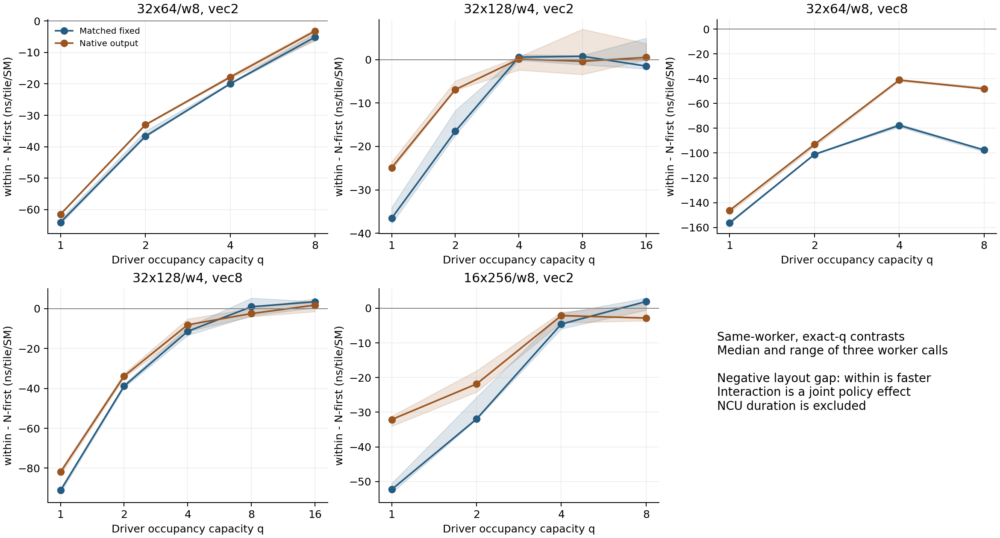
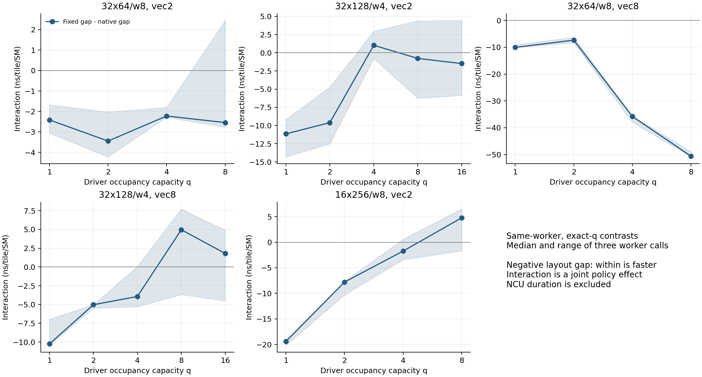

# Stage M2 — FULL 输出布局干预

本轮在 H100 上直接改变完整程序的输出策略，检验 M1 发现的输出转换缺口。没有重拟合选择器，没有修改 C34/D1 的文件、预测或主次模型归属；这些几何均已暴露，本轮不是新的盲测。

主要结果：输出策略确实改变了完整程序，但没有消除 q=1 的两个方向性反例。32×128/w4 vec2 的 within−NF 在 fixed/native 下分别为 −36.54/−24.88 ns，16×256/w8 为 −52.27/−32.10 ns，仍与冻结模型的正差分相反。

vec8 扩展还暴露了两个新的机制问题：三个静态最小范围为 warp 内的输出转换实际使用 shared；native 的 global-store sector 请求在全部四个 vec8 布局上均翻倍。不能用“删除 MO 就得到纯 MR”解释这些结果。

## 1. 协议、程序与计量口径

- 主对照：32×64/w8 与 32×128/w4 的 vec2，N-first/within × 固定输出/native 输出。
- 事前扩展：同两几何的 vec8，以及 16×256/w8 的 vec2。另保留旧固定输出 CUBIN，校验源代码改写的影响。
- 共 33 个逻辑程序：20 个 CPU 编译、13 个旧 CUBIN 复用。原 native SHA `fc5f2ad73f9f8c8ab31c3a01b8124329ccec391cdc5dbf2dafb2d42778cf6adb`，固定编译器 `20d9d98fead78c2f65e1b3ba5a7881d86a836dad`，无原生库重编。
- 99 项完整输出正确性与尾部 canary 检查通过；自然 q 与 q=1/2/4/8 同一 CUBIN、不同 launch shared reservation。q 是 occupancy capacity，不是瞬时实际驻留数。
- 三个独立 worker 调用，128/256/384 MiB 输入，三次随机访问 × 四个事件样本；保留 15,660 个原始样本。主指标为 time 对 grid/132 的 OLS 斜率（ns/tile/SM），128 MiB 原始时间另存。
- NCU 分开采集：6 份报告，软件动态指令用 grid=1，硬件用全图的 natural/q=1/q=4；全部本地 CPU 重新导入。NCU duration 不用于正式计时。

## 2. 固定输出与 native 输出下的布局差分

差分方向统一为 within − N-first；负数表示 within 更快。交互项为固定输出差分减 native 输出差分。下表取同 worker 配对后再取三 worker 中位数；范围与描述性 t 区间保留在 diagnostics.json。

| 几何 | vec | q | 固定输出差分 ns | native 差分 ns | 输出策略交互 ns | 新旧固定差分之差 ns |
|---|---:|---:|---:|---:|---:|---:|
| 16x256/w8 | 2 | 1 | -52.271 | -32.098 | -19.400 | 0.064 |
| 16x256/w8 | 2 | 8 | 1.934 | -2.836 | 4.770 | -0.129 |
| 32x64/w8 | 2 | 1 | -64.066 | -61.488 | -2.417 | -13.599 |
| 32x64/w8 | 2 | 8 | -5.124 | -3.190 | -2.546 | 1.482 |
| 32x64/w8 | 8 | 1 | -156.267 | -146.212 | -10.055 | 20.367 |
| 32x64/w8 | 8 | 8 | -97.485 | -48.146 | -50.596 | -0.838 |
| 32x128/w4 | 2 | 1 | -36.545 | -24.879 | -11.150 | -3.674 |
| 32x128/w4 | 2 | 16 | -1.482 | 0.516 | -1.482 | 0.064 |
| 32x128/w4 | 8 | 1 | -91.137 | -81.920 | -10.248 | 2.063 |
| 32x128/w4 | 8 | 16 | 3.480 | 1.805 | 1.805 | 2.320 |





这些是完整程序的输出策略干预。native 写出可能改变上游调度、局部 max 打包、store 向量化、参与线程和寄存器数；非零交互不自动等于纯 MO 延迟。反方向或接近零的结果与同方向结果一并保留。

## 3. 机器码、动态通信与写出

| 布局 | 静态最小转换范围 | 固定输出源行观察 | 固定 MO SHFL/BAR/LDS/STS | native MO | ML/local/MR 类别计数相同 | regs 固定/native | q 固定/native |
|---|---|---|---|---|---|---|---|
| M16_N256_w8:vec2:n_first | shared | shared | 0/16/8/16 | {} | True | 20/16 | 8/8 |
| M16_N256_w8:vec2:within | shuffle | shuffle | 16/0/0/0 | {} | True | 16/14 | 8/8 |
| M32_N128_w4:vec2:n_first | shared | shared | 0/8/4/8 | {} | True | 23/22 | 16/16 |
| M32_N128_w4:vec2:within | shuffle | shuffle | 8/0/0/0 | {} | True | 24/22 | 16/16 |
| M32_N128_w4:vec8:n_first | shuffle | shared | 0/8/4/8 | {} | True | 30/29 | 16/16 |
| M32_N128_w4:vec8:within | shuffle | shared | 0/4/4/8 | {} | True | 24/25 | 16/16 |
| M32_N64_w8:vec2:n_first | shuffle | shuffle | 16/0/0/0 | {} | True | 17/19 | 8/8 |
| M32_N64_w8:vec2:within | shared | shared | 0/16/2/8 | {} | True | 14/14 | 8/8 |
| M32_N64_w8:vec8:n_first | shuffle | shared | 0/16/8/16 | {} | True | 29/27 | 8/8 |
| M32_N64_w8:vec8:within | shared | shared | 0/16/8/16 | {} | True | 25/26 | 8/8 |

静态输出计划从 Blocked 的线性基与 reduction SliceLayout 的复制基枚举列所有者，区分线程内、warp 内或跨 warp 的最小通信范围。它不是延迟或最终指令数预测：后端还会进行分组、shuffle 分解与 shared swizzle。原编译器参考源码与 SHA 一同保存。

最小通信范围与实际输出策略在 7/10 个布局上同类，另外三个均是 vec8（32×64 N-first、32×128 N-first/within）：warp 内可达，后端却使用 shared。固定编译器 cvtNeedsWarpShuffle 还要求 mixedTranspositions.size() < 2；后续应补 vec4 并检验寄存器/lane 位交换数量，而不是把 warp 内可达等同于必用 shuffle。

源行只作来源定位：helper/unattributed 不强行分配；旧 one_pass 合并 load/cast/max 的源行仍保留为联合阶段。整核波前包括 ML、MR 与 MO；不能把整核 LDS 变化全部称为加载成本。动态 warp 指令数也不等于内存事务或周期。

| 布局 / 输出 | q | shared load 波前/CTA | shared load 冲突/CTA | global store sectors/CTA | DRAM 利用率 |
|---|---:|---:|---:|---:|---:|
| M16_N256_w8:vec2:n_first:fixed:ONE_FULL | natural | 105.849 | 1.849 | 32.000 | 89.550 |
| M16_N256_w8:vec2:n_first:native:ONE_FULL | natural | 89.569 | 1.569 | 32.000 | 88.870 |
| M16_N256_w8:vec2:within:fixed:ONE_FULL | natural | 129.068 | 65.068 | 32.000 | 88.940 |
| M16_N256_w8:vec2:within:native:ONE_FULL | natural | 129.182 | 65.182 | 32.000 | 89.000 |
| M32_N128_w4:vec2:n_first:fixed:ONE_FULL | natural | 84.844 | 0.844 | 16.000 | 87.390 |
| M32_N128_w4:vec2:n_first:native:ONE_FULL | natural | 76.718 | 0.718 | 16.000 | 85.820 |
| M32_N128_w4:vec2:within:fixed:ONE_FULL | natural | 128.751 | 64.751 | 16.000 | 87.070 |
| M32_N128_w4:vec2:within:native:ONE_FULL | natural | 128.762 | 64.762 | 16.000 | 87.050 |
| M32_N128_w4:vec8:n_first:fixed:ONE_FULL | natural | 133.173 | 1.173 | 16.000 | 83.920 |
| M32_N128_w4:vec8:n_first:native:ONE_FULL | natural | 115.814 | 1.814 | 32.000 | 83.880 |
| M32_N128_w4:vec8:within:fixed:ONE_FULL | natural | 132.852 | 64.852 | 16.000 | 84.590 |
| M32_N128_w4:vec8:within:native:ONE_FULL | natural | 128.965 | 64.965 | 32.000 | 86.210 |
| M32_N64_w8:vec2:n_first:fixed:ONE_FULL | natural | 65.148 | 1.148 | 8.000 | 77.890 |
| M32_N64_w8:vec2:n_first:native:ONE_FULL | natural | 51.157 | 1.157 | 8.000 | 76.830 |
| M32_N64_w8:vec2:within:fixed:ONE_FULL | natural | 34.768 | 0.768 | 8.000 | 79.350 |
| M32_N64_w8:vec2:within:native:ONE_FULL | natural | 32.880 | 0.880 | 8.000 | 80.170 |
| M32_N64_w8:vec8:n_first:fixed:ONE_FULL | natural | 169.805 | 1.805 | 8.000 | 40.720 |
| M32_N64_w8:vec8:n_first:native:ONE_FULL | natural | 131.236 | 2.236 | 16.000 | 45.950 |
| M32_N64_w8:vec8:within:fixed:ONE_FULL | natural | 40.363 | 0.363 | 8.000 | 53.250 |
| M32_N64_w8:vec8:within:native:ONE_FULL | natural | 32.676 | 0.676 | 16.000 | 52.720 |

vec2 的 native global-store sector 请求不变，而四个 vec8 的请求均为 fixed 的两倍（32×64：8→16 sectors/CTA；32×128：16→32）。输出字节和数学结果相同，但 per-instruction sector 请求可以重复覆盖同一 sector；这不等价于 HBM 写出字节翻倍。vec4 补点可检验是否在单线程 FP32 写出超过一条 128-bit store 后才出现请求放大。

native 不只删除显式 MO：例如 32×64 vec2 N-first 的 LDS 从 24→17，但 MO 原本只有 shuffle；部分额外 LDS 改变发生于 helper/unattributed 或 store 源行。下一项可检验假说是 native store 的参与线程让跨 warp reduction 的返回/广播读被剪枝；目前仅保留为待干预验证，不能将源行相同的 ML/MR 类别计数当成整个 lowering 完全相同。

## 4. 冻结模型的方向性反例复核

以下仍使用原冻结模型与开发集留一几何/D1 最终上下文；只代入真实容量 q。不把 native 输出算作原模型域内候选，也不据此更换 D1 赢家。

| 几何 / vec2, q=1 | 模型 | 原模型预测 fixed 差分 ns | 新源码 fixed 实测 ns | 旧 CUBIN fixed 实测 ns | native 实测 ns |
|---|---|---:|---:|---:|---:|
| 16x256/w8 | C34_full_auto | 15.011 | -52.271 | -51.820 | -32.098 |
| 16x256/w8 | C34_resource_only | 21.569 | -52.271 | -51.820 | -32.098 |
| 32x64/w8 | C34_full_auto | -56.127 | -64.066 | -50.177 | -61.488 |
| 32x64/w8 | C34_resource_only | -64.248 | -64.066 | -50.177 | -61.488 |
| 32x128/w4 | C34_full_auto | 113.761 | -36.545 | -31.840 | -24.879 |
| 32x128/w4 | C34_resource_only | 70.225 | -36.545 | -31.840 | -24.879 |

全部源改写桥接条件中，单 worker 新 fixed 相对旧 fixed 的最大绝对斜率变化为 1.955%；不把“寄存器数相同”当成机器码/性能完全相同。逐程序 CUBIN、opcode 与源行计数保留。

## 5. 推断边界与后续假说

- q 是容量控制，shared reservation 同时影响 CTA 调度/资源竞争；自然 q 的平坦表现不能证明每个子阶段成本相同。
- 将 native 输出与 fixed 输出比较，可检验输出策略是否参与布局差分；只能在 upstream/local、store 与资源匹配后讨论更窄的归因。
- 本轮不以拟合 η 或提高 D1 选择收益为目标。若保留方向性错误，继续把它记为 FULL 响应/特征不足，而不是通过重选 η 消除。
- 额外 GPU 干预须先记录新假说、变量、预期反例与测量矩阵；不删除本轮零效应或反向结果。

## 6. 证据与复现

- preregistration/protocol.json、source_snapshot.zip、operation_plans.json：先于编译/计时绑定。
- cpu_preflight、eligibility、timing、profiles：原始编译物、正确性、样本、NCU 报告与环境。
- analysis.json、diagnostics.json、tables、figures：可重算的斜率、配对交互、机器码来源与图。
- offline_import_validation.json、freeze.json、validation.json：本地报告复读与最终完整性。

```bash
OPENBLAS_NUM_THREADS=1 OMP_NUM_THREADS=1 MKL_NUM_THREADS=1 CUDA_VISIBLE_DEVICES='' \
  .venv/bin/python -m experiments.tma_reduction_layout.phase11.m2.analyze services
.venv/bin/python -m experiments.tma_reduction_layout.phase11.m2.analyze counters
.venv/bin/python -m experiments.tma_reduction_layout.phase11.m2.offline_import
.venv/bin/python -m experiments.tma_reduction_layout.phase11.m2.diagnose
.venv/bin/python -m experiments.tma_reduction_layout.phase11.m2.report
.venv/bin/python -m experiments.tma_reduction_layout.phase11.m2.validate --committed
```
