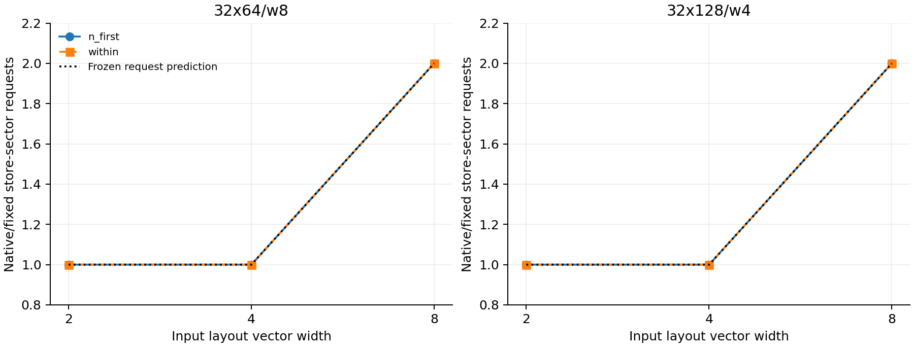
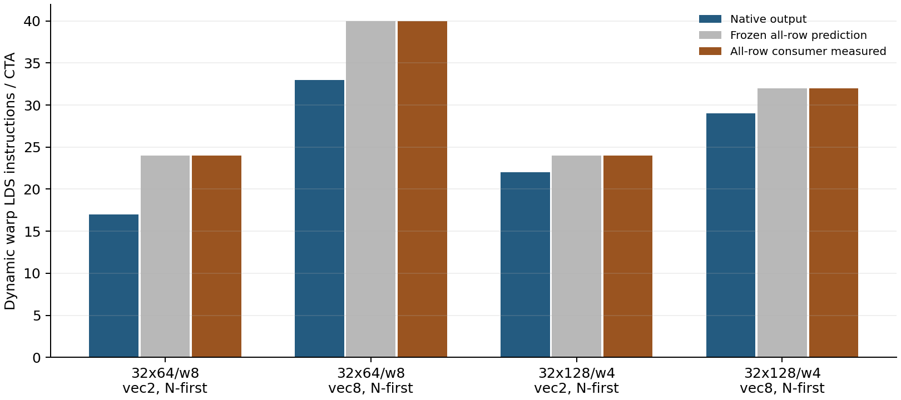
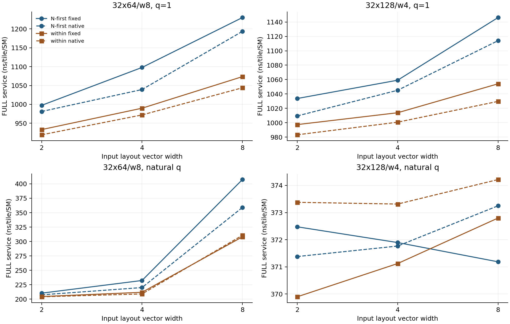

# Stage M3 — 输出转换阈值、写出请求与结果复制消费者

本轮针对 M2 新观察提出三个可证伪假说，并在接触 M3 编译/计时前冻结预测。没有更新选择器、重选 η、改变 D1 记分，或修改任何旧证据。

结果：转换策略匹配 **12/12**；fixed/native sector 请求匹配 **24/24**；全行消费的 LDS 预测匹配 **4/4**。其中 vec2/8 是已有 M2 锚点；新增 vec4 的前向检验为转换 **4/4**、sector **8/8**。四个全行消费者是新增程序。不能把全部 12/24 个锚点加补点当作完全未见检验。

## 1. 设计与原始证据

- 两个已有开发几何：32×64/w8、32×128/w4；vec2/4/8，N-first/within，fixed/native 输出，共 24 个 FULL 程序。新增 vec4、复用 M2 的 vec2/8；另含四个旧 vec4 固定输出桥接和两个原 T_control，共 30 个计时程序。
- 另有四个不同语义的诊断消费者：把每列 max 加上逻辑行号，写出 BM×BN 元素。它们只在 grid=1 下采集计数，不进入 FULL 计时、收益或模型评估。所有变化均是有效张量与布局，没有隐藏 lane/warp scalar。
- 共 34 个逻辑程序，12 个 CPU 编译、22 个 CUBIN 复用，102 项完整输出/尾部 canary 检查通过。原编译器 `20d9d98fead78c2f65e1b3ba5a7881d86a836dad` 与 native SHA 不变，复用缓存，无原生重编。
- 三个 H100 worker，14,580 个正式事件样本，主指标仍为 128/256/384 MiB FULL 的 grid/132 服务斜率（ns/tile/SM）。另有 6 份 NCU 报告并全部本地复读。

## 2. H1：warp 内可达，还需满足 shuffle 分解门限

受限的静态实现按 contiguous-N Blocked/Slice 的线性位基，投影由 warp 选择的 source lane 位、填充复制零基，再遍历寄存器/lane 置换循环。对应固定编译器 getWarpLayoutConvertDecomposition 与 cvtNeedsWarpShuffle 的规则：混合交换数 <2 时才自动选 shuffle。这个实现仅覆盖本轮布局族。

| 布局 | 最小通信范围 | 混合交换数 | 预先预测 | 源行/NCU 观察 | 匹配 |
|---|---|---:|---|---|---|
| M32_N64_w8:vec2:n_first | shuffle | 1 | shuffle | shuffle | True |
| M32_N64_w8:vec2:within | shared | None | shared | shared | True |
| M32_N64_w8:vec4:n_first | shuffle | 2 | shared | shared | True |
| M32_N64_w8:vec4:within | shared | None | shared | shared | True |
| M32_N64_w8:vec8:n_first | shuffle | 3 | shared | shared | True |
| M32_N64_w8:vec8:within | shared | None | shared | shared | True |
| M32_N128_w4:vec2:n_first | shared | None | shared | shared | True |
| M32_N128_w4:vec2:within | shuffle | 1 | shuffle | shuffle | True |
| M32_N128_w4:vec4:n_first | shuffle | 2 | shared | shared | True |
| M32_N128_w4:vec4:within | shuffle | 2 | shared | shared | True |
| M32_N128_w4:vec8:n_first | shuffle | 3 | shared | shared | True |
| M32_N128_w4:vec8:within | shuffle | 3 | shared | shared | True |

新增 vec4 的四个布局全部走 shared；可在 warp 内完成的三个布局，其受限混合交换数均为 2。阈值是当前编译器的自动策略，不能解释为硬件无法用 shuffle。这是编译器路径预测，不是每种路径的延迟模型；也不能把 static SHFL/LDS 数量直接线性相加为执行时间。

## 3. H2：vec4 与 vec8 的 global-store 请求粒度

静态预测按每个 warp、每条至多 128-bit 的 FP32 store 枚举访问 sector，跨指令重复访问的同一 sector重复计数。不是只按总输出字节除以 32B，也不是 HBM 写出流量模型。

| 布局 | fixed sectors/CTA 预测/实测 | native sectors/CTA 预测/实测 | 实测 native STG 类型与 warp 指令数 |
|---|---:|---:|---|
| M32_N64_w8:vec2:n_first | 8/8.000 | 8/8.000 | {'STG.E.64': 1} |
| M32_N64_w8:vec2:within | 8/8.000 | 8/8.000 | {'STG.E.64': 8} |
| M32_N64_w8:vec4:n_first | 8/8.000 | 8/8.000 | {'STG.E.128': 1} |
| M32_N64_w8:vec4:within | 8/8.000 | 8/8.000 | {'STG.E.128': 8} |
| M32_N64_w8:vec8:n_first | 8/8.000 | 16/16.000 | {'STG.E.128': 9} |
| M32_N64_w8:vec8:within | 8/8.000 | 16/16.000 | {'STG.E.128': 16} |
| M32_N128_w4:vec2:n_first | 16/16.000 | 16/16.000 | {'STG.E.64': 2} |
| M32_N128_w4:vec2:within | 16/16.000 | 16/16.000 | {'STG.E.64': 4} |
| M32_N128_w4:vec4:n_first | 16/16.000 | 16/16.000 | {'STG.E.128': 1} |
| M32_N128_w4:vec4:within | 16/16.000 | 16/16.000 | {'STG.E.128': 4} |
| M32_N128_w4:vec8:n_first | 16/16.000 | 32/32.000 | {'STG.E.128': 5} |
| M32_N128_w4:vec8:within | 16/16.000 | 32/32.000 | {'STG.E.128': 8} |

vec4 的四个新增布局中，native/fixed 的 sector 请求均相同；vec8 仍为 2 倍。比如 32×64 的 native vec4 每个活跃 owner 的四个 FP32 值可由一条 128-bit store 写出，vec8 需要两条，各次请求可覆盖同一 sector。这是 NCU 实测的请求计数，不是推断硬件把加载融合，也不是声称 HBM 写出量翻倍。



## 4. H3：更换结果消费者，检验被省去的返回读取

四个新增消费者的输入、load layout 和 max 语义相同，但每个逻辑行都需要 max 结果。预计 whole LDS 恢复为 M2 fixed 的 whole LDS 减显式 MO LDS。只比较动态计数与生成结构；输出字节数不同，因此没有原 FULL 性能对比。

| N-first 布局 | native LDS | 预先预测全行 LDS | 实测全行 LDS | MAX 计数相同 | SHFL 计数相同 | ML load 计数相同 | regs native/全行 |
|---|---:|---:|---:|---|---|---|---|
| M32_N64_w8:vec2:n_first:broadcast:ONE_FULL | 17 | 24 | 24 | True | True | True | 19/22 |
| M32_N64_w8:vec8:n_first:broadcast:ONE_FULL | 33 | 40 | 40 | True | True | True | 27/29 |
| M32_N128_w4:vec2:n_first:broadcast:ONE_FULL | 22 | 24 | 24 | True | True | True | 22/32 |
| M32_N128_w4:vec8:n_first:broadcast:ONE_FULL | 29 | 32 | 32 | True | True | True | 29/35 |

实测 LDS 分别为 17→24、33→40、22→24、29→32，均命中事前预测；四项 MAX、SHFL 和源行可定位 ML load 计数均保持不变。寄存器仍变化，其中 32×128 vec8 从 29→35，容量 q 从 16→12，因此仍不据此推算原 FULL 的返回广播时间。



若计数和上游类别同时匹配，结果支持“消费者参与情况影响 reduction-result 返回读取”，而不是“删除 MO 后的 LDS 全部属于原始 ML”。计数匹配仍不等于独立测得返回广播延迟：不同消费者的排程、寄存器分配和写出均可能改变。

## 5. vec2→vec4→vec8 的完整程序响应

以下只是本轮同 worker 的完整程序实测，不拟合新模型。三 worker 的配对差分取中位数；保留全部 q、worker 与范围。

| 几何 | vec | q | fixed within−NF ns | native within−NF ns | 输出策略交互 ns |
|---|---:|---:|---:|---:|---:|
| 32×64/w8 | 2 | 1 | -63.261 | -62.197 | -1.063 |
| 32×64/w8 | 2 | 8 | -4.995 | -3.867 | -1.579 |
| 32×64/w8 | 4 | 1 | -107.959 | -67.934 | -40.315 |
| 32×64/w8 | 4 | 8 | -20.947 | -11.602 | -9.442 |
| 32×64/w8 | 8 | 1 | -156.589 | -147.920 | -9.442 |
| 32×64/w8 | 8 | 8 | -99.097 | -48.308 | -51.079 |
| 32×128/w4 | 2 | 1 | -36.352 | -25.846 | -11.215 |
| 32×128/w4 | 2 | 16 | 0.193 | 0.645 | -0.451 |
| 32×128/w4 | 4 | 1 | -44.859 | -44.344 | -0.516 |
| 32×128/w4 | 4 | 16 | 0.967 | 0.773 | -0.580 |
| 32×128/w4 | 8 | 1 | -92.168 | -81.791 | -9.861 |
| 32×128/w4 | 8 | 16 | 1.418 | 0.838 | 0.773 |



## 6. 对模型意味着什么

- 输出操作计划至少需要：转换的寄存器/lane 置换结构、编译器实际选择的 shuffle/shared 路径、全局 store 的指令分组与 sector 请求、消费者对结果副本的需求。仅有 fanout 或两个 MO 布尔标记不足以表达这些差异。
- 本轮验证的是结构机制及其 FULL 响应，不是校准后的独立阶段延迟，也没有证明一个新的选择器优于 fixed_vec1。M2 的 q=1 方向错误仍是冻结时间模型的反例。
- 后续若更新模型，应先以同语义完整程序的操作计划重做开发集 CV，并按相同输入/消费者边界限定适用域；当前计数不能直接作为一组等权成本。
- 本轮结束后停止，不自动进入跨架构、编译器 Pass 或 PR。

## 7. 复现

```bash
OPENBLAS_NUM_THREADS=1 OMP_NUM_THREADS=1 MKL_NUM_THREADS=1 CUDA_VISIBLE_DEVICES='' \
  .venv/bin/python -m experiments.tma_reduction_layout.phase11.m3.analyze services
.venv/bin/python -m experiments.tma_reduction_layout.phase11.m3.analyze counters
.venv/bin/python -m experiments.tma_reduction_layout.phase11.m3.offline_import
.venv/bin/python -m experiments.tma_reduction_layout.phase11.m3.diagnose
.venv/bin/python -m experiments.tma_reduction_layout.phase11.m3.report
.venv/bin/python -m experiments.tma_reduction_layout.phase11.m3.validate --committed
```
