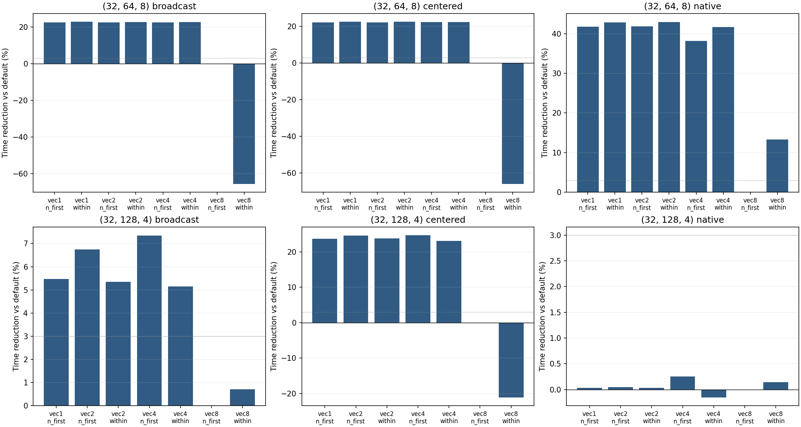

# M4b 主要结果

本轮真实消费者是 x.to(float32)-column_max(x.to(float32))，是二维规约后广播减法子图，未冒充完整 softmax/LayerNorm。
native/broadcast/centered 的全部 15 个布局均测量；在每个消费者自身语义内对比，输出字节数不同的消费者之间不直接计算布局收益。

## 1. 自然驻留结果

实测最快是探索性事后统计，不是冻结选择器：

| geometry | consumer | 最快布局 | gain vs default | gain vs fixed_vec1 | vs vec1 paired t95 (%) |
| --- | --- | --- | --- | --- | --- |
| (32, 64, 8) | broadcast | M32_N64_w8:vec1:within | +22.91% | +0.72% | [0.65, 0.79] |
| (32, 64, 8) | centered | M32_N64_w8:vec2:within | +22.68% | +0.62% | [0.05, 1.19] |
| (32, 64, 8) | native | M32_N64_w8:vec2:within | +42.98% | +2.00% | [1.11, 2.88] |
| (32, 128, 4) | broadcast | M32_N128_w4:vec4:n_first | +7.35% | +1.98% | [1.5, 2.47] |
| (32, 128, 4) | centered | M32_N128_w4:vec4:n_first | +24.74% | +1.38% | [1.1, 1.65] |
| (32, 128, 4) | native | M32_N128_w4:vec4:n_first | +0.25% | +0.22% | [-2.01, 2.45] |

## 2. 事前关心的 vec2/4:within 能否同时击败默认和 vec1

保留全部正、零、负结果；均为 centered 同语义内比较：

| geometry | 布局 | gain vs default | gain vs fixed_vec1 | vs vec1 paired t95 (%) |
| --- | --- | --- | --- | --- |
| (32, 64, 8) | M32_N64_w8:vec2:within | +22.68% | +0.62% | [0.05, 1.19] |
| (32, 64, 8) | M32_N64_w8:vec4:within | +22.46% | +0.33% | [-0.15, 0.82] |
| (32, 128, 4) | M32_N128_w4:vec2:within | +23.81% | +0.16% | [-0.19, 0.52] |
| (32, 128, 4) | M32_N128_w4:vec4:within | +23.11% | -0.77% | [-0.9, -0.64] |

是否优于简单基线应由上述配对区间与 3% 实用门槛判断，而不能仅凭最快点估计宣称胜出。
宽化输入有第二个消费者后，max lowering、返回读取、store 分组、寄存器与驻留都可能变化；详见 REPORT.md 全矩阵和 diagnostics.json 的实际 PTX/SASS/PC/q。
本轮没有把共享内存波前、shuffle 或 spill 的静态站点数当作总时间成本，也没有为获得期望赢家改变代码或样本口径。

## 3. 消费者导致真实 lowering 与资源变化

下表 LDS/MAX 为单 CTA 的 warp 指令实例，PTX 是静态站点，不能混为同一数量：

| geometry | vec | consumer | regs | q_cap | LDS | dynamic MAX | PTX max sites |
| --- | --- | --- | --- | --- | --- | --- | --- |
| 32x64/w8 | 1 | native | 16 | 8 | 74 | 48 | {'max.bf16': 7, 'max.f32': 2} |
| 32x64/w8 | 1 | broadcast | 32 | 8 | 80 | 48 | {'max.bf16': 7, 'max.f32': 2} |
| 32x64/w8 | 1 | centered | 26 | 8 | 80 | 72 | {'max.f32': 9} |
| 32x64/w8 | 8 | native | 27 | 8 | 33 | 320 | {'max.f32': 40} |
| 32x64/w8 | 8 | broadcast | 29 | 8 | 40 | 320 | {'max.f32': 40} |
| 32x64/w8 | 8 | centered | 32 | 8 | 40 | 320 | {'max.f32': 40} |
| 32x128/w4 | 1 | native | 32 | 16 | 128 | 64 | {'max.bf16': 31} |
| 32x128/w4 | 1 | broadcast | 32 | 16 | 128 | 64 | {'max.bf16': 31} |
| 32x128/w4 | 1 | centered | 48 | 10 | 128 | 124 | {'max.f32': 31} |
| 32x128/w4 | 8 | native | 29 | 16 | 29 | 128 | {'max.bf16x2': 12, 'max.f32': 24} |
| 32x128/w4 | 8 | broadcast | 35 | 12 | 32 | 128 | {'max.bf16x2': 12, 'max.f32': 24} |
| 32x128/w4 | 8 | centered | 60 | 8 | 32 | 192 | {'max.f32': 48} |

32×128/w4 vec8:N-first 的 native→broadcast→centered：regs 29→35→60，q_cap 16→12→8，返回 LDS 29→32→32。
centered 的宽化输入有第二个消费者，原 BF16 packed-max 站点转为 FP32，符合事前“多消费者可能改变 packing/liveness”的结构假说。
vec1 的 32→48 个寄存器及 q=16→10 也保留，不能把资源变化只归到默认 vec8。
这些是编译/执行真值，不是从寄存器数直接换算出来的性能损失。
预定义 conversion 指令族计数为0也不表示拓宽免费：32×128/w4 默认 centered 的 widening 源行实际有128次 IMAD.U32和32次 PRMT warp 指令实例；完整 opcode/PC 保留在 diagnostics.json。

## 4. 匹配二维 copy 控制给出的重要限定

copy 控制保留默认 vec8:N-first 输入/输出布局，只去掉 max/广播减法，仍写出同样的 FP32 二维 tile：

| geometry | 程序 | service ns/tile/SM | 128 MiB 原始 µs |
| --- | --- | --- | --- |
| 32x64/w8 | control:ONE_TRANSFER | 201.985 | 54.987 |
| 32x64/w8 | copy_control:ONE_COPY | 650.536 | 168.133 |
| 32x64/w8 | vec8:n_first:sw128:centered:ONE_FULL | 704.193 | 182.517 |
| 32x64/w8 | vec1:n_first:sw128:centered:ONE_FULL | 547.873 | 141.397 |
| 32x128/w4 | control:ONE_TRANSFER | 374.795 | 51.920 |
| 32x128/w4 | copy_control:ONE_COPY | 1453.654 | 190.613 |
| 32x128/w4 | vec8:n_first:sw128:centered:ONE_FULL | 1463.516 | 188.923 |
| 32x128/w4 | vec1:n_first:sw128:centered:ONE_FULL | 1116.715 | 143.413 |

32×128/w4 的默认 centered 为 1463.516 ns，默认布局 copy 已达 1453.654 ns（约差 0.68%）。
因此“q 从16降至8”确实发生，但不足以证明它造成约25%的布局差距；输出/传输组织本身已经形成高平台。
原来只有 1D 首行写出的 T_control 约 374.795 ns，不能直接作为这个二维写出程序的传输屋顶。
同样，128 MiB 原始时间与服务斜率存在截距差异，不能混用两种口径证明因果。

本轮只给 copy 控制测了默认布局，没有完整 copy×layout 矩阵，因此仍不能把候选的收益全部分配给 store、输入或 MR。
静态 store-sector 请求在 45/45 个 consumer/layout 条件命中；vec8 的二维请求为 vec1/2/4 的2倍，仍然是请求数，不是 DRAM 写字节数翻倍的结论。

## 5. 新反例：更少 BAR/WF 并不保证更快

centered 的 vec8:within 比默认 vec8:N-first 更慢：32×64/w8 慢约65.98%，32×128/w4 慢约21.18%。
其 BAR 和 shared-load WF 都更少，而输出 sector 请求仍相同：

| geometry | placement | q_cap | BAR warp inst | load WF/CTA | store sectors/CTA | MIO % | issue % | DRAM % |
| --- | --- | --- | --- | --- | --- | --- | --- | --- |
| 32x64/w8 | n_first | 8 | 80 | 177.13 | 512 | 28.03 | 29.07 | 66.82 |
| 32x64/w8 | within | 8 | 16 | 40.07 | 512 | 52.55 | 15.74 | 40.85 |
| 32x128/w4 | n_first | 8 | 40 | 143.78 | 1024 | 35.18 | 9.05 | 64.92 |
| 32x128/w4 | within | 12 | 8 | 137.44 | 1024 | 18.75 | 7.26 | 63.66 |

例如 32×64/w8 同为 q_cap=8、store sectors=512，但 within 的 MIO 比例升至52.55%、issue降至15.74%，DRAM利用率降至40.85%。
这是现有简单指令/波前加和模型不能闭合的反例。MIO 是全 kernel 指标，仍不能据此唯一归因于某条 SHFL、shared 指令或全局写出。
后续可以预注册完整 copy×layout/q 与指令依赖/请求组织对照检验该假说；本轮没有看到异常后临时扩展 GPU 采集或改写旧模型。

## 6. 与简单基线的证据边界

两个真实 centered 几何的最快候选相对默认分别快22.68%和24.74%，但相对 fixed_vec1 仅约0.62%和1.38%，均低于3%实用差异门槛。
事前关心的 vec2/4:within 没有在本批证明同时以>3%优势击败默认与 fixed_vec1；32×128/w4 的最快是 vec4:N-first。
本轮扩充并检验了消费者敏感的操作计划，验证了实际优化空间，也明确保留了简单基线仍强和时间模型尚未完全闭合的边界。

